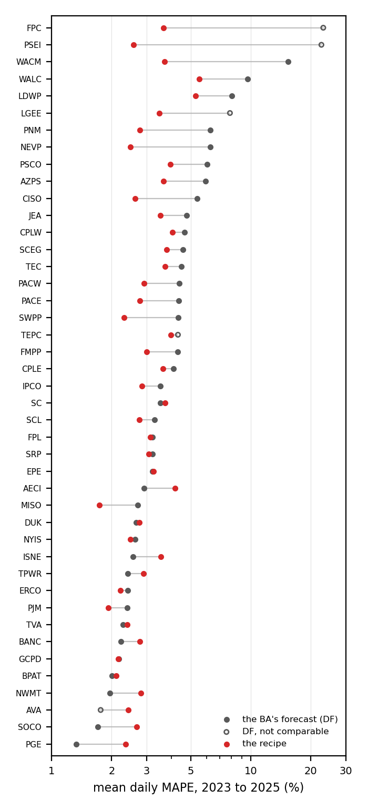

# ba-load-forecast

Day-ahead load forecasting for US balancing authorities (BAs) with public data only, scored against each
BA's own day-ahead forecast. Part of [Cardinal Grid](https://cardinalgrid.com), an independent open
initiative.

> Status: **recipe fixed after phase O and run once on the 43 BAs of the station map** (2023 to 2025,
> 9 a.m. cut-off, protocol v2): ahead of the BAs' own forecasts in 26 of the 38 comparable BAs, behind at
> the peak of the extreme days. The phases below record how it got there; nothing is tuned after phase O.

Documentation: `docs/methods.md` (every rule, model and parameter, with the reason), `docs/reproduce.md`
(inputs and commands in order), and one report per phase (`docs/phase_b.md`, `docs/phase_c.md`,
`docs/phase_d.md`, `docs/hrrr_verification.md`, `docs/day_clusters.md`).

## The question

Every BA reports to the EIA, every hour, the demand that occurred (`D`) and the forecast it made the day
before (`DF`). Cardinal Grid Note 1 measured that forecast across 42 BAs: a weighted MAPE of 3.6 %,
under-forecasts at the daily peak on 59 % of days, and, in the winter storms of 2021 to 2025, peak
under-forecasts of 9 to 14 % at some BAs, early in the storms as the weather worsened (FERC/NERC 2025).
Can an open system, with public load, public weather forecasts and explicit handling of special days,
beat that operational forecast, on ordinary days and on the cold mornings?

## The rules the data layer enforces

**Cut-off.** The forecast for day `D` uses load through the hour beginning 08:00 local time of `D-1`
(everything a forecaster running at 9 a.m. would have) and the latest HRRR run whose initialisation plus
2 h of processing is not after 09:00 local of `D-1`. With the UTC offsets the EIA files carry, that is
the 12 UTC run in standard time everywhere, and the 06 UTC run in the Eastern zone in daylight time.
Forecast leads are 17 to 45 h.

**Weather.** Temperature forecasts come from the HRRR archive on AWS Open Data (`s3://hrrrzarr`), read at
the grid cell nearest each BA's representative station (35 stations, none more than 2 km from its cell).
Runs reach 48 h from 2 December 2020, which sets the start of the evaluation period. Observed temperature
(NOAA ISD-Lite) is used for training and for two reference runs only: perfect weather (a ceiling) and
persistence (the last observed temperature at the same hour, a floor). It never enters a forecast. NOAA's ISD
archive ends on 27 August 2025; from that day the observations come from its successor, NOAA's GHCNh, for the
same airports, and from the Iowa Environmental Mesonet's ASOS archive for the hours GHCNh lacks (`docs/methods.md`,
section 2).

**Comparison.** Every forecast is scored against `DF` for the same BA and day, under the same cut-off.

## How good is the weather input? (December 2020 to 2025)

`docs/hrrr_verification.md` compares the HRRR 2 m temperature at each station's grid cell with the
ISD-Lite observation for the same hour, over the leads a 9 a.m. forecast uses (17 to 45 h), from
2 December 2020 to the end of 2025: 3.5 million pairs at 35 stations.

- Overall the forecast runs slightly cool: bias −1.2 °F, MAE 3.1 °F, RMSE 4.0 °F. The MAE grows from
  about 3.0 °F at the shortest leads to about 3.5 °F at 45 h.
- The sign flips with temperature. Below 20 °F the forecast is warm on average (+1.4 °F, MAE 3.8 °F),
  between 20 and 32 °F +0.5 °F, and above 32 °F cool by 1.0 to 1.5 °F.
- On the 30 coldest mornings of each station (hours 04:00 to 09:00 local), the sign depends on the place:
  warm at Columbia SC (+5.7 °F), Moses Lake (+3.6 °F), Portland (+3.0 °F) and Spokane (+2.8 °F); cold at
  Miami (−5.1 °F), Phoenix (−5.0 °F) and Tampa (−4.0 °F), whose "coldest mornings" are mild in absolute
  terms.
- In the four winter storms (all hours of the event days), the pooled bias is between −0.5 °F (Uri) and
  −1.6 °F (January 2025), with MAE 3.3 to 3.7 °F. The largest warm errors are in the Pacific Northwest
  during Elliott (Portland +7.5 °F, Spokane +4.9 °F) and at Denver during Uri (+4.0 °F); during Elliott the
  forecast was cold in the Southeast (Louisville −4.9 °F, Nashville −4.5 °F, Atlanta −3.2 °F).

A forecast that runs warm on a cold morning pushes a temperature-driven load forecast down, which is the
direction of the errors the storm reviews describe. Whether that is what happened at any BA is a question
for the forecasting phases, not for this table: at the Southeast stations, where the largest Elliott
under-forecast was reported, the public weather forecast erred cold, not warm.

## Results of phases B to D

`docs/phase_b.md`, `docs/phase_c.md` and `docs/phase_d.md` score the model families against the BA's own
forecast on the ten development BAs (PJM, MISO, ERCOT, CAISO, SPP, NYISO, ISO-NE, TVA, Duke, BPA) from
2 December 2020 to the end of 2022, under the 9 a.m. cut-off, with the HRRR temperature as the only
weather input. Mean over the BA-days on which every model of phase D produced a forecast (7253), weighted
by each BA's demand; documented load-shed days (`docs/load_shed_days.csv`) left out:

| Model | Stations per BA | Training | MAPE (%) | Median MAPE (%) | Under-forecast at the peak (%) | Days with lower MAPE than `DF` |
|---|---|---|---|---|---|---|
| Ensemble of the additive model and the boosting, weighted by recent error | 4 to 5 | 6 years | 2.76 | 2.40 | −1.99 | 56 % |
| Additive model with an empirical bias correction | 4 to 5 | 6 years | 2.80 | 2.41 | −1.84 | 55 % |
| Gradient boosting | 4 to 5 | 6 years | 2.90 | 2.54 | −1.92 | 53 % |
| The BA's own forecast (`DF`) | | | 3.01 | 2.70 | −1.10 | |
| Additive model (per-hour splines) | 4 to 5 | 6 years | 3.03 | 2.66 | −2.28 | 51 % |
| Gradient boosting | 4 to 5 | 2 years | 3.08 | 2.66 | −2.05 | 50 % |
| Additive model | 1 | 6 years | 3.57 | 3.03 | −2.47 | 43 % |
| Recency-effect regression (Hong) | 4 to 5 | 6 years | 3.66 | 3.19 | −2.23 | 41 % |
| Recency-effect regression (Hong) | 1 | 2 years | 4.27 | 3.64 | −2.49 | 33 % |
| Profile of Note 2 | 1 | | 6.86 | 5.29 | −4.34 | 21 % |

## Phase E: the recipe, in one run (`docs/phase_e_final.md`)

Phase E adds FPL to the development set, settles the recipe and runs it once on the eleven BAs (8163 BA-days,
2 December 2020 to 31 December 2022). The recipe: the additive model with special-day indicators and the
boosting, each on four to six stations per BA and six years of history, combined by their recent error, with
a bias correction read from the errors of the known days in the same temperature regime over the last year;
at ISO-NE and CAISO the additive model carries two linear terms for the installed PV capacity and the boosting
carries the sun's elevation and the HRRR cloud cover as seen at the cut-off. The 90 % interval is read at a level
that adapts to the coverage achieved, one level per regime.

| | MAPE (%) | Median MAPE (%) | Under-forecast at the peak (%) | Days with lower MAPE than `DF` | Coverage of the 90 % interval: year / storms / coldest mornings |
|---|---|---|---|---|---|
| Recipe (`final`) | **2.56** | 2.23 | −1.85 | 61 % | 89.5 % / 76.9 % / 80.7 % |
| The BA's own forecast (`DF`) | 3.04 | 2.74 | −1.26 | | |
| `DF` with its own trailing hourly bias removed (`docs/df_hourly_bias.md`) | 2.17 | | | | |

By BA (MAPE, recipe against `DF`; the Diebold-Mariano test on daily MAPE is significant at 5 % everywhere except FPL):
ahead at PJM (2.34 against 3.65), SPP (2.42 against 3.85), MISO (2.09 against 2.65), NYISO (2.45 against 2.67) and
CAISO (2.64 against 2.80); even at FPL (3.91 against 3.92); behind at ERCOT (2.79 against 2.63), BPA (2.52 against
2.07), Duke (3.31 against 2.84), TVA (3.04 against 2.23) and ISO-NE (3.43 against 2.36). Against `DF` with its
hourly bias removed the recipe is ahead only at SPP.

What each step of phase E was worth, on the same days (`docs/phase_e.md`, `docs/phase_e_sky.md`, `docs/phase_e_pv.md`,
`docs/phase_e_pv2.md`, `docs/phase_e_intervals2.md`):

- **Bias correction by temperature regime** instead of the last 60 days: 2.66 % to 2.58 %; it is also what absorbs the
  Gulf Power step at FPL (July 2022, +11 %) within weeks.
- **Sky features in the boosting** (the short-wave flux is empty in the public HRRR Zarr archive until 2025, so the
  sun's elevation and the total cloud cover stand in): ISO-NE 3.74 % to 3.57 %, CAISO 2.76 % to 2.70 %, FPL unchanged.
- **Installed PV capacity** (Forms EIA-861M and EIA-860M) inside the boosting: nothing, because trees do not extrapolate a
  capacity that is always above its training range. As two linear terms of the additive model (the simplest load
  reconstitution): ISO-NE 3.58 % to 3.43 %, CAISO 2.71 % to 2.65 %. The midday gap to ISO-NE's own forecast narrows by
  0.3 to 0.4 point and remains (about 5 % against 2 % at 11:00): no public forecast irradiance exists at the cut-off
  for these years.
- **Intervals**: the regime-conditional errors read at an adaptive level per regime reach the nominal coverage over the
  year with bands 4 % narrower than adaptive conformal inference alone; inside the storms and on the coldest mornings
  every variant covers 77 to 81 % of the hours.
- **The benchmark itself** (`docs/df_hourly_bias.md`): PJM's published `DF` is stamped one hour earlier than its demand
  from February 2019 on (moved by one hour its MAPE is 2.3 to 2.5 %, not 3.4 to 3.9 %); NYISO's is 2.4 % low at every
  hour, MISO's and SPP's 1 to 4 % high, ISO-NE's 3 to 6 % low before dawn, FPL's 4 to 7 % low in the evening. The
  recipe beats the forecasts as published; it does not yet beat the forecasters.

What the tables say, so far:

- **Several weather stations per BA and six years of training are the two levers that matter.** With one
  airport and two years no model reaches the operators; with four or five stations and six years the
  boosting alone is below the BAs' aggregate, and the ensemble of the additive model and the boosting is
  0.25 point below it, ahead on 56 % of the days. The ensemble beats the BA's forecast at PJM (2.64 %
  against 3.65 %), SPP (2.53 % against 3.88 %), MISO (2.26 % against 2.64 %) and NYISO (2.51 % against
  2.66 %), and loses at ERCOT, CAISO, Duke, TVA, BPA and, by a wide margin, ISO-NE (3.87 % against 2.36 %).
- **A cheap bias correction helps:** the median of the model's relative errors over the last 60 known days,
  per hour of the day, applied to the forecast, takes the additive model from 3.03 % to 2.80 % and reduces
  its under-forecast at the peak more than anything else tried (−2.28 % to −1.84 %).
- **Explicit cold and heat terms** add nothing on top of the spline response with a linear tail.
  **Cleaning the history with grid-data-sentinel** instead of the gross-fault guard changes the annual mean
  by 0.01 point. **Data-driven day labels** from the shape clusters (`docs/day_clusters.md`) make every
  model worse: within a temperature regime the normalised shape barely depends on the calendar.
- **Special days:** on the special days themselves (247 BA-days) indicators take the additive model from
  3.92 % to 3.59 %, below the BA's 3.69 %; on the eves the BAs stay ahead (3.43 % against 3.55 % for the
  ensemble). A separate special-day model changes nothing.
- **At the daily peak the models still under-forecast more than the operators** (−1.8 to −2.0 % against
  −1.1 %). Inside the storms, the bias-corrected additive model matches or beats the BA at the peak in
  Winter Storm Elliott at seven of the ten BAs (PJM −1.2 % against −3.1 %, NYISO −0.5 % against −3.4 %),
  and in Uri at five; the boosting is the worst of the models at the peak outside its training range
  (ERCOT in Uri, −12.9 %).
- **Prediction intervals** (5th to 95th percentile) are too narrow where they matter: empirical intervals
  around the additive model cover 85 % of the hours over the year, 72 % inside the storms and 76 % on the
  30 coldest mornings of each BA; the quantile boosting covers less. Calibration by regime is open work.

Caveats: the training history is cleaned of gross faults only (readings outside 0.2 to 5 times the
four-week median); on the days when a BA shed firm load the "load that occurred" is the load served, so
those BA-days are left out of every table; the BAs' forecasters use weather vendors and internal
information that this study does not have.

## Phase F: three fixes where the recipe lost (`docs/phase_f_final.md`)

Phase F tried one change for each limitation of phase E and kept two. **Coldest days**: the median correction and the
band are read from the 40 known days of the target day's regime nearest in forecast minimum temperature
(`docs/phase_e_intervals3.md`): coverage on the coldest mornings 80.7 % to 84.3 %, band wider there only, and a
slightly better point (2.56 % to 2.53 %); an exponential tail beyond the pool's outer deciles changed nothing.
**Peak**: the point is read at the 60th percentile of the errors around the forecast peak (`docs/phase_e_peak.md`),
because the actual peak is a maximum over noisy hours and the error measured there is biased downward even for an
unbiased forecast: under-forecast at the peak −1.85 % to −1.44 % for 0.016 point of MAPE, better at all 22 event-BA
pairs. **Forecast irradiance** (`docs/phase_e_irradiance.md`): the HRRR surface short-wave flux, read from the GRIB2
archive by byte range because the Zarr archive lacks it before 2025, did not help at ISO-NE or CAISO and was not
adopted.

The recipe after phase F, in one run on the eleven BAs (8163 BA-days):

| | MAPE (%) | Median MAPE (%) | Error at the peak (%) | Under-forecast at the peak (%) | Days with lower MAPE than `DF` | Coverage of the 90 % interval: year / storms / coldest mornings |
|---|---|---|---|---|---|---|
| Recipe after phase F (`final2`) | **2.55** | 2.21 | +0.10 | **−1.37** | 61 % | 88.9 % / 79.0 % / 84.6 % |
| Recipe after phase E (`final`) | 2.56 | 2.23 | −0.79 | −1.85 | 61 % | 89.5 % / 76.9 % / 80.7 % |
| The BA's own forecast (`DF`) | 3.04 | 2.74 | +0.09 | −1.26 | | |
| `DF` with its own trailing hourly bias removed | 2.17 | | | | | |

By BA the picture of phase E holds (ahead at PJM, SPP, MISO, NYISO and CAISO, even at FPL, behind at ERCOT, BPA,
Duke, TVA and ISO-NE; Diebold-Mariano significant everywhere except FPL). Inside the storms the under-forecast at the
peak is now −2.64 % in Uri and −2.55 % in Elliott, against −2.00 % and −2.43 % for `DF`, and the daily MAPE is still
behind the BAs' (3.89 % against 3.62 % in Uri, 4.54 % against 4.49 % in Elliott). What remains open is written in the
limitations: the midday hours at ISO-NE, the storms, and the distance to the forecasters' own accuracy.

## Frozen evaluation: 2023 to 2025, nothing changed (`docs/frozen_evaluation.md`)

Every number above comes from the 25 months on which the recipe was chosen. The recipe was then frozen and run once
on the three following years, 1 January 2023 to 31 December 2025, on the same eleven BAs (10 470 BA-days), with the
models learning day by day from the six years before each day as they would in operation, and nothing changed
after these numbers were seen.

| | MAPE (%) | Median MAPE (%) | Error at the peak (%) | Under-forecast at the peak (%) | Days with lower MAPE than `DF` | Coverage of the 90 % interval: year / storms / coldest mornings |
|---|---|---|---|---|---|---|
| Recipe (`final2`) | **2.52** | 2.18 | +0.06 | −1.37 | 62 % | 89.1 % / 80.8 % / 84.5 % |
| The BA's own forecast (`DF`) | 3.22 | 2.90 | −0.08 | −1.31 | | |
| `DF` with its own trailing hourly bias removed (`docs/df_hourly_bias_2023_2025.md`) | 2.16 | | | | | |

By year: 2.74 % against 2.95 % in 2023, 2.83 % against 3.10 % in 2024, 3.13 % against 3.63 % in 2025. By BA the
picture of the development period holds: ahead at PJM (2.28 against 3.53), SPP (2.54 against 3.43), MISO (1.91 against
2.73) and CAISO; even at NYISO (2.87 against 2.94, the one BA where the Diebold-Mariano test is not significant);
behind at ERCOT, FPL, BPA, Duke, TVA and ISO-NE (3.85 against 2.55). CAISO needs a caveat: its published `DF` breaks
down over these years (5.5 %, 7.0 %, 8.1 %) because, by CAISO's own OASIS series, the EIA-930 demand column has carried
hour labels one hour off since 14 June 2022 while the forecast column equals CAISO's day-ahead forecast exactly, and
because CAISO's forecast error against its own actual load also grew (2.5 % in January 2022, 6.1 % in January 2025); the
2.81 % against 6.73 % there is a win over the published data, not over the forecaster. Inside the two winter
events of the period the recipe is behind at the peak in January 2024 (−3.45 % against −2.45 %) and level in January
2025 (−2.61 % against −2.63 %), with the daily MAPE slightly behind in the first and ahead in the second. The
interval coverage is where the development left it: at the nominal level over the year, 81 % inside the storms.

Against `DF` with its own hourly bias removed the recipe is ahead at SPP only. The public data's forecasts
are beaten in three years the recipe never saw; the forecasters are not.

## Protocol v2: the benchmark with its labels fixed (`docs/phase_g_protocol.md`)

After the frozen run the evaluation gained three data rules: a day with a reporting fault in the published forecast (missing, zero, or more than 50 % off the outcome at any hour) or a spike in the outcome (an hour more than 40 % off its neighbours) is left out for everyone, and the documented hour-label offsets of the published series are applied on reading (PJM's forecast one hour early from February 2019, CAISO's demand one hour late from 14 June 2022, both checked against the operators' own published data). The recipe barely moves (2.54 %); the benchmark improves to 2.69 % (PJM 2.45 %, CAISO 2.38 %). Under these rules the recipe is ahead by 0.15 point on the development period, better on 53 % of the days, ahead at PJM, SPP, MISO and NYISO, level at FPL, behind at the other six. This is the evaluation used from here on.

## Phase G: more features, a third member, and a second look at 2023 to 2025

Phase G kept two of the many things it tried (`docs/methods.md`, section 8e): more load memory and the thermal history of the previous days as features of both members, and the recency regression as a third member of the ensemble. The recipe after phase G (`final3`) reaches **2.46 %** on the development period against 2.54 % for the phase F recipe and 2.69 % for `DF` under protocol v2, better at all eleven BAs (`docs/phase_g_final.md`), and **2.44 % against 2.90 %** on 2023 to 2025 (`docs/frozen_evaluation_v2.md`; a second look, since the phase F recipe had already been scored there; 2.50 % for that recipe under the same rules, `docs/frozen_evaluation_final2_v2.md`), ahead at PJM, SPP, MISO and CAISO and behind at the other seven, ahead in each year with the gap widening in 2025 as the published forecasts worsen. Against `DF` with its own hourly bias removed (2.05 %) the recipe is ahead at SPP only.

## Phase H: humidity, the largest summer gain

Phase H added the dew point and the wind (observed from the same NOAA files as the temperature, forecast from the HRRR archive) and, from them, the relative humidity, the NWS heat index and wind chill and the apparent temperature (`docs/methods.md`, section 8f). The humidity block in the boosting and the apparent temperature in the additive model take the recipe from 2.47 % to **2.40 %** on the development period on the same days, better at all eleven BAs, with the gain in summer (0.15 point in June to September) and almost none in winter (`docs/phase_h_humidity_only.md`, `docs/phase_h_humidity_by_season.md`). Wind and wind chill helped the boosting alone but not the recipe and were not adopted. The recipe after phase H is `final4`: on 2023 to 2025 under protocol v2 it gives **2.38 % against 2.90 %** for `DF` (`docs/frozen_evaluation_v3.md`; 2.44 % for the phase G recipe on the same days), ahead at PJM, SPP, MISO and CAISO, level at NYISO and ERCOT, behind at the other five; 2.05 % for `DF` with its own hourly bias removed.

## Phase I: the extremes, and the whole distribution

Phase I ran four recipes side by side on the same days of 2020 to 2022, which contain Winter Storms Uri and Elliott, and judged them on the event days, the 30 coldest mornings and the 30 largest peaks of each BA as well as on the year (`docs/methods.md`, section 8g; `docs/phase_i_events_strata.md`). A robust (absolute-error) loss in the boosting was worse over the year and lowered the peak in the storms, and was not adopted. Two changes were kept: the wind block in the boosting only, neutral over the year and 0.13 point better on the event days at nine of the eleven BAs, and the point read at the 70th percentile around the peak on the coldest decile of days, which takes the under-forecast at the peak on the coldest mornings from -2.41 % to -2.14 % and in Elliott from -3.35 % to -3.03 % at no annual cost. The recipe now issues 23 quantiles, scored by the CRPS (1.70 % over the year, 2.56 % on the event days) and the Winkler score beside the coverage. The recipe after phase I is `final5`: on 2020 to 2022 it matches the phase H recipe over the year and is 0.15 point better on the event days (`docs/phase_i_final.md`); on 2023 to 2025 under protocol v2 it gives **2.38 % against 2.90 %** for `DF`, the same as the phase H recipe over the year, with the under-forecast at the peak in the January 2024 and January 2025 storms going from -2.79 % to -2.36 % and on the coldest mornings from -2.36 % to -1.95 % (`docs/frozen_evaluation_v4.md`, `docs/phase_i_frozen_strata.md`; CRPS 1.73 % over the year, 2.35 % on the event days).

## Phase J: three more candidates for the extremes, none adopted

Three cheaper ideas for the storm days were tried on the same days as phase I (`docs/methods.md`, section 8h; `docs/phase_j_strata.md`): averaging the cut-off HRRR run with the run six hours older (worse by 0.005 over the year, better only at CAISO), the peak percentile extended to the hottest decile of days (peak of the hottest days 0.32 point better, but summer MAPE worse by 0.035 at every BA) and cold-day training weights (event-day MAPE worse by 0.12). The recipe stays `final5`.

## Phase K: a second weather model, the largest gain since the stations

The National Blend of Models (NBM, NOAA) was read at the same stations from its public archive and verified against the observations: it errs a third less than the HRRR (MAE 2.05 F against 3.12 F, `docs/nbm_verification.md`) but is too warm in the cold. Averaging its 2 m temperature with the HRRR path, hour by hour, takes the recipe from 2.40 % to **2.29 %** on 2020 to 2022 on the same days, better at all eleven BAs; using the NBM alone or reading the cold-day peak rule from its minimum were not adopted (`docs/methods.md`, section 8i; `docs/phase_k_strata.md`). The recipe after phase K is `final6`: on 2023 to 2025 under protocol v2 it gives **2.22 % against 2.90 %** for `DF` (`docs/frozen_evaluation_v5.md`), 0.16 point better than the phase I recipe at every BA, every season and every year (`docs/phase_k_frozen_strata.md`), ahead of `DF` at seven of the eleven BAs (PJM, MISO, SPP, CAISO, ERCOT, NYISO, FPL) and behind at BPA, Duke, TVA and ISO-NE; CRPS 1.61 % over the year, the 90 % band narrower (10.8 % of the load) at the same coverage (89.2 %). The archive lacks 7.5 % of the runs, among them 16 to 21 January 2024; those days use the HRRR alone.

## Phase L: tuning the blend

A 0.7 weight on the NBM and a correction of the NBM by its own cold-hour bias were tried on six BAs against the plain mean (`docs/methods.md`, section 8j; `docs/phase_l_strata.md`): the weight gains at Duke and loses at FPL and SPP (0.002 over the year, worse at the largest peaks), the correction changes nothing. The NBM dew point and wind blended into the fields (four BAs) and the NBM irradiance in the PV term (ISO-NE and CAISO, worse by 0.04) were tried next and not adopted either. The recipe stays `final6`.

## Phase M: a third weather model

The GFS 0.25 degree temperature was read at the same stations from its public archive (2021 to 2025) and verified: it errs more than the HRRR at the point (MAE 3.30 F against 3.12 F; the NBM 2.05 F, `docs/gfs_verification.md`) and is the warmest of the three on cold mornings. Averaged with the HRRR and the NBM, equal weight, on the six BAs of phase L it is worse than the phase K recipe by 0.02 over the year, 0.04 in winter and 0.05 on the coldest mornings; only FPL gains (0.17). Not adopted (`docs/methods.md`, section 8k; `docs/phase_m_strata.md`). The recipe stays `final6`.

## Phase N: the weather models weighted per station

The temperature path became the mean of the HRRR, the NBM and the GFS weighted, per station and per day, by the inverse of each model's squared error at that station's observations over the last 30 days known at the cut-off, with the GFS left out on days below the station's cold decile (`docs/methods.md`, section 8l; `docs/phase_n_strata_all.md`). Weighting the HRRR and the NBM alone changes nothing; the GFS, let in where it helps and kept out of the cold, gains 0.02 over the year on the eleven BAs (8 better, 1 worse), 0.06 in summer and 0.08 at the largest peaks, with the whole distribution slightly sharper; the event days and the coldest mornings do not move. On 2023 to 2025 under protocol v2 (`docs/frozen_evaluation_v6.md`, `docs/phase_n_frozen_strata.md`, an estimate after six looks) `final8` gives **2.20 % against 2.90 %** for `DF`, ahead of the phase K recipe at ten BAs and equal at one, by 0.02 over the three years and 0.04 on the event days and the coldest mornings. The recipe is now `final8`.

## Phase O: a storm member, and the band on the coldest days

A boosting member fitted on the coldest decile of days and used on such days only was tried against the phase N recipe on six winter BAs and not adopted: the event days move by 0.007 and the peak under-forecast deepens (`docs/methods.md`, section 8m). The band was then reworked on the cold-decile days: the adaptive level is read at a quarter of its value and the outer quantiles come from an exponential tail fitted beyond the pool's 10th and 90th percentiles, so that the band can pass the largest error seen in the 40 nearest days. The NBM's own spread (the standard deviation of its blend) was then tried as a width factor and won on its own: on 2023 to 2025 the 90 % interval covers the event days at 89.6 % (82.0 % before) and the 30 coldest mornings at 88.6 % (84.4 %) with a lower Winkler score in both, for 0.4 % of Winkler over the three years; the point forecast does not change (`docs/phase_o_frozen_band_spread_alone_strata.md`). The recipe's band is now `final10s`; the cold-day level and tail (`final10a2t`) stay as the alternative without the NBM spread. The calibration of the 23 quantiles (`docs/calibration_curves.md`) shows what is left: on the event days the whole distribution sits low, a shift of location that no widening repairs.

## Phase P: the recipe on the 43 BAs of the station map

The recipe of phase O, unchanged, was run once on every BA of the station map with data on 2023 to 2025: the eleven development BAs and 32 others with one station each (`docs/methods.md`, section 8n; reports `docs/evaluation_43_bas.md`, `docs/scoreboard_43_bas.md`, `docs/evaluation_43_bas_strata.md`). Five BAs (AVA, FPC, LGEE, PSEI, TEPC) publish a forecast the EIA lists as not comparable with their demand; they stay in the evaluation and leave the scoreboard against `DF`.

| 2023 to 2025, days both scored | BAs | MAPE recipe, weighted | MAPE `DF`, weighted | median BA, recipe | median BA, `DF` | BAs better | BAs worse |
|---|---|---|---|---|---|---|---|
| comparable BAs | 38 | 2.41 % | 3.16 % | 2.86 % | 3.40 % | 26 | 12 |
| of which never seen in development | 27 | 3.18 % | 4.14 % | 3.07 % | 4.29 % | 19 | 8 |
| development BAs | 11 | 2.21 % | 2.90 % | 2.40 % | 2.63 % | 7 | 4 |

The margin grows where the published forecast is weak (WACM, NEVP, PNM, PSCO, CISO, SWPP) and turns into a loss where it is very good (PGE, SOCO, NWMT, ISNE, BANC, TPWR) and at AECI. MAPE is lower than `DF` in every stratum, event days included (3.30 % against 3.63 %), but at the daily peak of the event days and of the 30 largest peaks of each BA the recipe under-forecasts more than `DF` does (−2.43 % against −2.33 %, −1.83 % against −1.41 %). The 90 % band covers 88 to 90 % of the hours in every BA.



## Layout

| Module | Responsibility |
|---|---|
| `hrrr_grid.py` | Nearest HRRR grid cell and Zarr chunk for each station |
| `hrrr.py` | Point reads from the public archive; resumable extraction to parquet; consolidation per station |
| `cutoff.py` | The 9 a.m. rule: the run available for each BA-day, leads, the forecast temperature of a day |
| `information_set.py` | `Loader.information_set(ba, day)`: load history to the cut-off, forecast and observed temperature, the BA's `DF`, the outcome |
| `scripts/extract_hrrr.py` | Extraction command line (`scripts/run_extract.cmd` runs it detached, year by year) |
| `scripts/verify_hrrr.py` | HRRR against ISD-Lite: error by station, lead, month, temperature and on the coldest mornings |

## Install and use

```bash
pip install -e ".[hrrr,dev]"          # needs grid-data-sentinel[pandas] for the public-data helpers
python scripts/extract_hrrr.py --start 2020-12-02 --end 2025-12-31 --init-hours 12 6
python scripts/extract_hrrr.py --consolidate
python scripts/verify_hrrr.py --years 2024
```

```python
from datetime import date
from ba_load_forecast.information_set import Loader

loader = Loader(tidy_dir="../ba-forecast-scorecard/data/tidy", isd_dir="data/isd", hrrr_dir="data/hrrr")
info = loader.information_set("PJM", date(2024, 1, 17))
info.load_history          # hourly load, local hour beginning, ends 2024-01-16 08:00
info.run                   # (2024-01-16, 12): the HRRR run available at the cut-off
info.temp_forecast_f       # 24 values for 2024-01-17 from that run
info.ba_forecast, info.actual   # the BA's DF and what occurred, for scoring
```

Tests: `pytest -q` (synthetic data; the tests that touch the archives are marked `network` and skipped by
default).

## Data sources

EIA-930 hourly demand and day-ahead forecast (tidy files from
[ba-forecast-scorecard](https://github.com/cardinalgrid/ba-forecast-scorecard)); NOAA ISD-Lite hourly
observations; HRRR forecasts from the [AWS Open Data archive](https://registry.opendata.aws/noaa-hrrr-pds/)
in Zarr (`hrrrzarr`, maintained by the University of Utah); from 27 August 2025, when the ISD archive stops,
hourly observations from NOAA's GHCNh (its successor), completed by the Iowa Environmental Mesonet's ASOS archive
where GHCNh has holes. The station assignment per BA is the one of
Cardinal Grid Note 2 and of [grid-data-sentinel](https://github.com/cardinalgrid/grid-data-sentinel).

## Limitations

One to six stations per BA on the eleven development BAs and a single station on the other 32, which is a thin description of a large or scattered system. The recipe is behind the BAs' own forecasts at the daily peak of the extreme days. The 9 a.m. cut-off is an assumption about when BAs run their forecasts. The HRRR is a
weather model with its own error, not the forecast any BA used, and the 2 h availability lag is a
convention. Nothing here describes the internal process of any operator.

## License

Apache-2.0. Ricardo Guerra, Cardinal Grid (independent open initiative).
