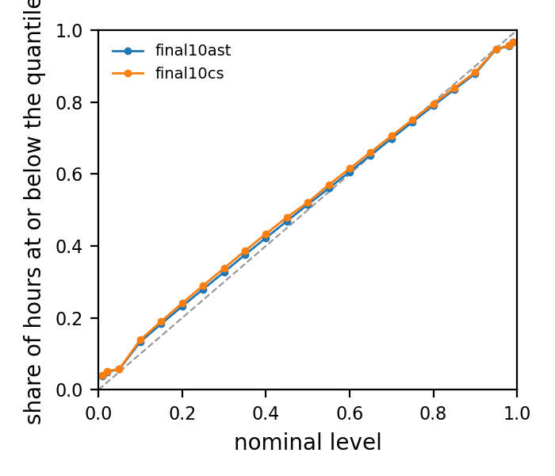
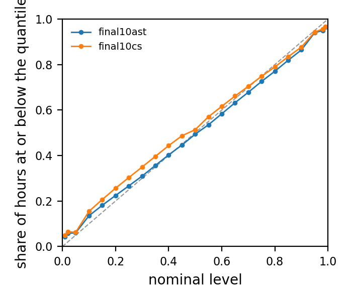
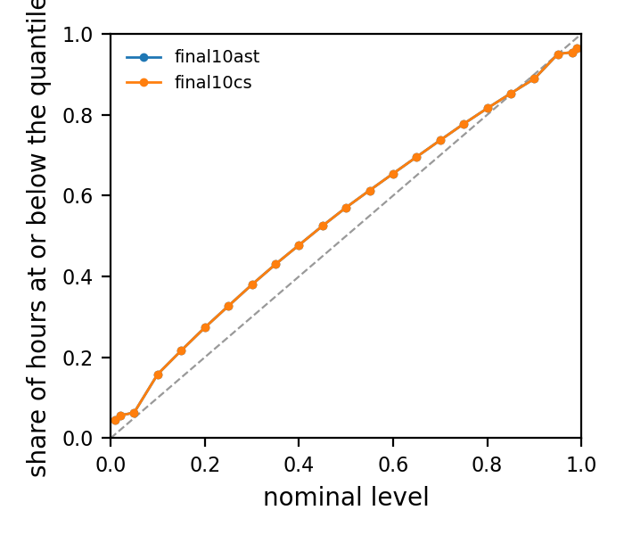
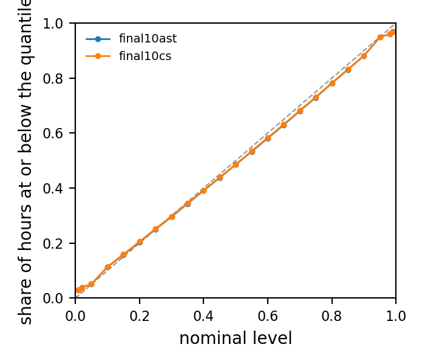
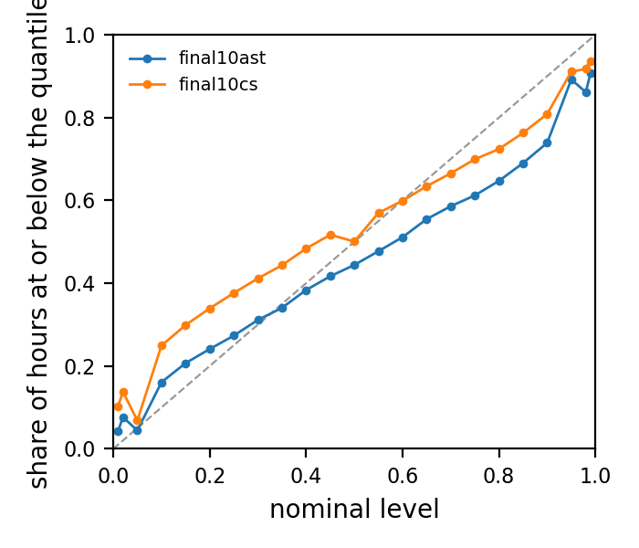
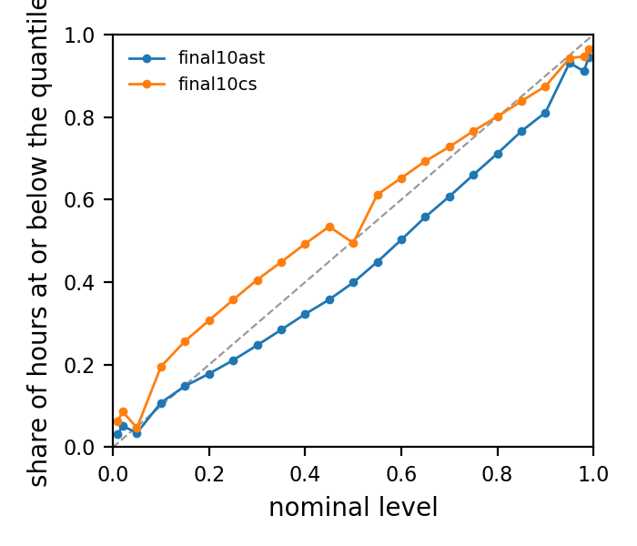
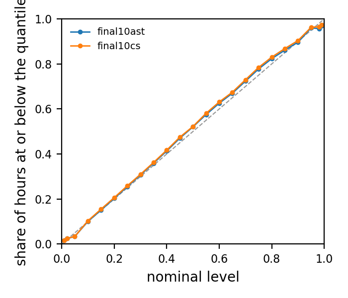

# Calibration of the issued quantiles, by stratum

Models: band_ast@~/ba-load-forecast-runs/phase_e:final10ast, band_cs@~/ba-load-forecast-runs/phase_e:final10cs. BAs: PJM, MISO, SWPP, DUK, TVA, ERCO; the days every model scored, pooled over the BAs (hours weighted equally). A quantile at nominal level q is calibrated when the actual load falls at or below it a share q of the hours; the mean absolute calibration error averages |empirical - nominal| over the issued levels.

## Summary

| stratum | model | levels | hours | mean_abs_calibration_error | worst_level_error |
| --- | --- | --- | --- | --- | --- |
| all | final10ast | 23 | 108744 | 0.02 | 0.03 |
| all | final10cs | 23 | 108744 | 0.02 | 0.04 |
| winter | final10ast | 23 | 29976 | 0.02 | 0.04 |
| winter | final10cs | 23 | 29976 | 0.03 | 0.06 |
| summer | final10ast | 23 | 35064 | 0.05 | 0.08 |
| summer | final10cs | 23 | 35064 | 0.05 | 0.08 |
| shoulder | final10ast | 23 | 43704 | 0.01 | 0.02 |
| shoulder | final10cs | 23 | 43704 | 0.01 | 0.02 |
| events | final10ast | 23 | 1536 | 0.07 | 0.16 |
| events | final10cs | 23 | 1536 | 0.07 | 0.15 |
| cold_mornings | final10ast | 23 | 4320 | 0.06 | 0.10 |
| cold_mornings | final10cs | 23 | 4320 | 0.05 | 0.11 |
| top_peaks | final10ast | 23 | 4320 | 0.01 | 0.03 |
| top_peaks | final10cs | 23 | 4320 | 0.02 | 0.03 |

## all

| nominal | final10ast | final10cs |
| --- | --- | --- |
| 0.01 | 0.04 | 0.04 |
| 0.02 | 0.05 | 0.05 |
| 0.05 | 0.06 | 0.06 |
| 0.10 | 0.13 | 0.14 |
| 0.15 | 0.18 | 0.19 |
| 0.20 | 0.23 | 0.24 |
| 0.25 | 0.28 | 0.29 |
| 0.30 | 0.33 | 0.34 |
| 0.35 | 0.38 | 0.39 |
| 0.40 | 0.42 | 0.43 |
| 0.45 | 0.47 | 0.48 |
| 0.50 | 0.52 | 0.52 |
| 0.55 | 0.56 | 0.57 |
| 0.60 | 0.61 | 0.62 |
| 0.65 | 0.65 | 0.66 |
| 0.70 | 0.70 | 0.71 |
| 0.75 | 0.74 | 0.75 |
| 0.80 | 0.79 | 0.80 |
| 0.85 | 0.84 | 0.84 |
| 0.90 | 0.88 | 0.88 |
| 0.95 | 0.95 | 0.95 |
| 0.98 | 0.96 | 0.96 |
| 0.99 | 0.97 | 0.97 |

## winter

| nominal | final10ast | final10cs |
| --- | --- | --- |
| 0.01 | 0.04 | 0.05 |
| 0.02 | 0.06 | 0.07 |
| 0.05 | 0.06 | 0.06 |
| 0.10 | 0.14 | 0.15 |
| 0.15 | 0.18 | 0.21 |
| 0.20 | 0.22 | 0.26 |
| 0.25 | 0.27 | 0.30 |
| 0.30 | 0.31 | 0.35 |
| 0.35 | 0.36 | 0.40 |
| 0.40 | 0.40 | 0.44 |
| 0.45 | 0.45 | 0.49 |
| 0.50 | 0.49 | 0.51 |
| 0.55 | 0.54 | 0.57 |
| 0.60 | 0.58 | 0.62 |
| 0.65 | 0.63 | 0.66 |
| 0.70 | 0.68 | 0.70 |
| 0.75 | 0.73 | 0.75 |
| 0.80 | 0.77 | 0.79 |
| 0.85 | 0.82 | 0.83 |
| 0.90 | 0.86 | 0.88 |
| 0.95 | 0.94 | 0.94 |
| 0.98 | 0.95 | 0.96 |
| 0.99 | 0.96 | 0.97 |

## summer

| nominal | final10ast | final10cs |
| --- | --- | --- |
| 0.01 | 0.04 | 0.04 |
| 0.02 | 0.06 | 0.06 |
| 0.05 | 0.06 | 0.06 |
| 0.10 | 0.16 | 0.16 |
| 0.15 | 0.22 | 0.22 |
| 0.20 | 0.27 | 0.27 |
| 0.25 | 0.33 | 0.33 |
| 0.30 | 0.38 | 0.38 |
| 0.35 | 0.43 | 0.43 |
| 0.40 | 0.48 | 0.48 |
| 0.45 | 0.53 | 0.53 |
| 0.50 | 0.57 | 0.57 |
| 0.55 | 0.61 | 0.61 |
| 0.60 | 0.65 | 0.65 |
| 0.65 | 0.70 | 0.70 |
| 0.70 | 0.74 | 0.74 |
| 0.75 | 0.78 | 0.78 |
| 0.80 | 0.82 | 0.82 |
| 0.85 | 0.85 | 0.85 |
| 0.90 | 0.89 | 0.89 |
| 0.95 | 0.95 | 0.95 |
| 0.98 | 0.95 | 0.95 |
| 0.99 | 0.96 | 0.96 |

## shoulder

| nominal | final10ast | final10cs |
| --- | --- | --- |
| 0.01 | 0.03 | 0.03 |
| 0.02 | 0.04 | 0.04 |
| 0.05 | 0.05 | 0.05 |
| 0.10 | 0.11 | 0.11 |
| 0.15 | 0.16 | 0.16 |
| 0.20 | 0.20 | 0.21 |
| 0.25 | 0.25 | 0.25 |
| 0.30 | 0.30 | 0.30 |
| 0.35 | 0.34 | 0.35 |
| 0.40 | 0.39 | 0.39 |
| 0.45 | 0.44 | 0.44 |
| 0.50 | 0.49 | 0.49 |
| 0.55 | 0.53 | 0.53 |
| 0.60 | 0.58 | 0.58 |
| 0.65 | 0.63 | 0.63 |
| 0.70 | 0.68 | 0.68 |
| 0.75 | 0.73 | 0.73 |
| 0.80 | 0.78 | 0.78 |
| 0.85 | 0.83 | 0.83 |
| 0.90 | 0.88 | 0.88 |
| 0.95 | 0.95 | 0.95 |
| 0.98 | 0.96 | 0.96 |
| 0.99 | 0.97 | 0.97 |

## events

| nominal | final10ast | final10cs |
| --- | --- | --- |
| 0.01 | 0.04 | 0.10 |
| 0.02 | 0.08 | 0.14 |
| 0.05 | 0.04 | 0.07 |
| 0.10 | 0.16 | 0.25 |
| 0.15 | 0.21 | 0.30 |
| 0.20 | 0.24 | 0.34 |
| 0.25 | 0.27 | 0.38 |
| 0.30 | 0.31 | 0.41 |
| 0.35 | 0.34 | 0.44 |
| 0.40 | 0.38 | 0.48 |
| 0.45 | 0.42 | 0.52 |
| 0.50 | 0.44 | 0.50 |
| 0.55 | 0.48 | 0.57 |
| 0.60 | 0.51 | 0.60 |
| 0.65 | 0.55 | 0.63 |
| 0.70 | 0.59 | 0.67 |
| 0.75 | 0.61 | 0.70 |
| 0.80 | 0.65 | 0.72 |
| 0.85 | 0.69 | 0.76 |
| 0.90 | 0.74 | 0.81 |
| 0.95 | 0.89 | 0.91 |
| 0.98 | 0.86 | 0.92 |
| 0.99 | 0.91 | 0.94 |

## cold_mornings

| nominal | final10ast | final10cs |
| --- | --- | --- |
| 0.01 | 0.03 | 0.06 |
| 0.02 | 0.05 | 0.09 |
| 0.05 | 0.03 | 0.05 |
| 0.10 | 0.11 | 0.20 |
| 0.15 | 0.15 | 0.26 |
| 0.20 | 0.18 | 0.31 |
| 0.25 | 0.21 | 0.36 |
| 0.30 | 0.25 | 0.41 |
| 0.35 | 0.28 | 0.45 |
| 0.40 | 0.32 | 0.49 |
| 0.45 | 0.36 | 0.53 |
| 0.50 | 0.40 | 0.50 |
| 0.55 | 0.45 | 0.61 |
| 0.60 | 0.50 | 0.65 |
| 0.65 | 0.56 | 0.69 |
| 0.70 | 0.61 | 0.73 |
| 0.75 | 0.66 | 0.77 |
| 0.80 | 0.71 | 0.80 |
| 0.85 | 0.77 | 0.84 |
| 0.90 | 0.81 | 0.87 |
| 0.95 | 0.93 | 0.94 |
| 0.98 | 0.91 | 0.95 |
| 0.99 | 0.95 | 0.96 |

## top_peaks

| nominal | final10ast | final10cs |
| --- | --- | --- |
| 0.01 | 0.02 | 0.02 |
| 0.02 | 0.02 | 0.03 |
| 0.05 | 0.03 | 0.03 |
| 0.10 | 0.10 | 0.10 |
| 0.15 | 0.15 | 0.16 |
| 0.20 | 0.20 | 0.21 |
| 0.25 | 0.26 | 0.26 |
| 0.30 | 0.31 | 0.31 |
| 0.35 | 0.36 | 0.36 |
| 0.40 | 0.41 | 0.42 |
| 0.45 | 0.47 | 0.47 |
| 0.50 | 0.52 | 0.52 |
| 0.55 | 0.58 | 0.58 |
| 0.60 | 0.63 | 0.63 |
| 0.65 | 0.67 | 0.67 |
| 0.70 | 0.72 | 0.73 |
| 0.75 | 0.78 | 0.78 |
| 0.80 | 0.82 | 0.83 |
| 0.85 | 0.86 | 0.87 |
| 0.90 | 0.90 | 0.90 |
| 0.95 | 0.96 | 0.96 |
| 0.98 | 0.96 | 0.97 |
| 0.99 | 0.97 | 0.97 |
