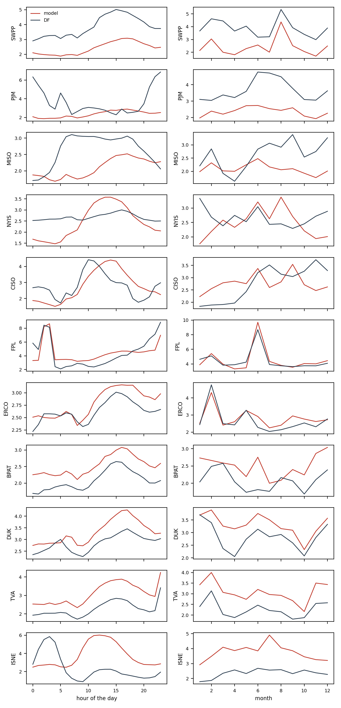

# Where the model loses to the BA's forecast

Hourly percentage errors of `ens_bc_regime` and of the BA's own forecast (`DF`) on the development period, documented load-shed days left out. `mape_gap` is the model's MAPE minus the BA's: positive where the BA is better. `bias` is the mean signed error: negative means under-forecast.

## By BA

| ba | mape_model | mape_df | bias_model | bias_df | n | mape_gap |
| --- | --- | --- | --- | --- | --- | --- |
| SWPP | 2.41 | 3.86 | 0.02 | 3.18 | 18070 | -1.45 |
| PJM | 2.35 | 3.66 | -0.10 | -1.23 | 18166 | -1.31 |
| MISO | 2.08 | 2.65 | -0.02 | 2.18 | 18091 | -0.57 |
| NYIS | 2.45 | 2.67 | -0.01 | -2.35 | 18190 | -0.22 |
| CISO | 2.77 | 2.79 | -0.22 | -1.20 | 18134 | -0.02 |
| FPL | 4.46 | 4.39 | -0.12 | -2.07 | 17602 | 0.07 |
| ERCO | 2.79 | 2.63 | 0.08 | 0.19 | 18046 | 0.16 |
| BPAT | 2.52 | 2.08 | -0.16 | 0.45 | 18142 | 0.44 |
| DUK | 3.32 | 2.85 | 0.21 | 0.35 | 18165 | 0.47 |
| TVA | 3.09 | 2.27 | 0.41 | 0.44 | 18071 | 0.82 |
| ISNE | 3.74 | 2.36 | 0.25 | -1.41 | 18190 | 1.38 |

## SWPP

MAPE 2.41 % against 3.86 % for `DF`. Largest gaps by hour: 0h (+-0.80), 1h (+-1.02), 8h (+-1.17), 5h (+-1.19); by month: 6 (+-0.61), 8 (+-0.98), 7 (+-1.21). Model bias from 10h to 15h minus its bias at night: +0.17 points; midday bias by year: {2020: 0.3, 2021: 0.36, 2022: -0.15}.

## PJM

MAPE 2.35 % against 3.66 % for `DF`. Largest gaps by hour: 15h (+0.47), 17h (+0.41), 14h (+0.28), 18h (+0.24); by month: 2 (+-0.65), 4 (+-0.80), 5 (+-0.88). Model bias from 10h to 15h minus its bias at night: +0.19 points; midday bias by year: {2020: -0.04, 2021: -0.21, 2022: 0.23}.

## MISO

MAPE 2.08 % against 2.65 % for `DF`. Largest gaps by hour: 23h (+0.22), 0h (+0.17), 1h (+0.14), 2h (+0.01); by month: 4 (+0.38), 3 (+0.09), 5 (+0.06). Model bias from 10h to 15h minus its bias at night: +0.13 points; midday bias by year: {2020: 0.05, 2021: -0.11, 2022: 0.26}.

## NYIS

MAPE 2.45 % against 2.67 % for `DF`. Largest gaps by hour: 13h (+0.77), 14h (+0.72), 12h (+0.70), 11h (+0.62); by month: 8 (+0.93), 9 (+0.42), 3 (+0.20). Model bias from 10h to 15h minus its bias at night: +0.33 points; midday bias by year: {2020: -1.08, 2021: 0.26, 2022: 0.2}.

## CISO

MAPE 2.77 % against 2.79 % for `DF`. Largest gaps by hour: 15h (+1.34), 14h (+1.26), 18h (+1.09), 19h (+0.99); by month: 4 (+0.89), 3 (+0.88), 2 (+0.67). Model bias from 10h to 15h minus its bias at night: -0.04 points; midday bias by year: {2020: -1.09, 2021: -0.81, 2022: 0.22}.

## FPL

MAPE 4.46 % against 4.39 % for `DF`. Largest gaps by hour: 5h (+1.36), 13h (+1.27), 12h (+1.22), 11h (+1.14); by month: 6 (+1.01), 7 (+0.43), 12 (+0.36). Model bias from 10h to 15h minus its bias at night: -1.67 points; midday bias by year: {2020: -0.23, 2021: -0.63, 2022: -1.12}.

## ERCO

MAPE 2.79 % against 2.63 % for `DF`. Largest gaps by hour: 18h (+0.34), 23h (+0.32), 21h (+0.30), 19h (+0.30); by month: 6 (+0.64), 9 (+0.63), 11 (+0.31). Model bias from 10h to 15h minus its bias at night: +0.21 points; midday bias by year: {2020: -0.79, 2021: -0.07, 2022: 0.61}.

## BPAT

MAPE 2.52 % against 2.08 % for `DF`. Largest gaps by hour: 1h (+0.61), 0h (+0.56), 17h (+0.56), 18h (+0.53); by month: 6 (+0.94), 11 (+0.76), 1 (+0.69). Model bias from 10h to 15h minus its bias at night: +0.03 points; midday bias by year: {2020: -0.26, 2021: -0.14, 2022: -0.08}.

## DUK

MAPE 3.32 % against 2.85 % for `DF`. Largest gaps by hour: 16h (+0.89), 15h (+0.85), 17h (+0.81), 14h (+0.79); by month: 4 (+1.10), 3 (+0.89), 7 (+0.67). Model bias from 10h to 15h minus its bias at night: -0.03 points; midday bias by year: {2020: 1.06, 2021: -0.24, 2022: 0.64}.

## TVA

MAPE 3.09 % against 2.27 % for `DF`. Largest gaps by hour: 19h (+1.15), 18h (+1.08), 16h (+1.07), 13h (+1.06); by month: 4 (+1.07), 3 (+1.04), 1 (+1.02). Model bias from 10h to 15h minus its bias at night: -0.10 points; midday bias by year: {2020: 1.45, 2021: -0.5, 2022: 1.3}.

## ISNE

MAPE 3.74 % against 2.36 % for `DF`. Largest gaps by hour: 10h (+4.17), 11h (+4.02), 12h (+3.82), 9h (+3.73); by month: 7 (+2.35), 5 (+1.75), 3 (+1.74). Model bias from 10h to 15h minus its bias at night: +0.42 points; midday bias by year: {2020: -2.15, 2021: -0.05, 2022: 1.34}.

