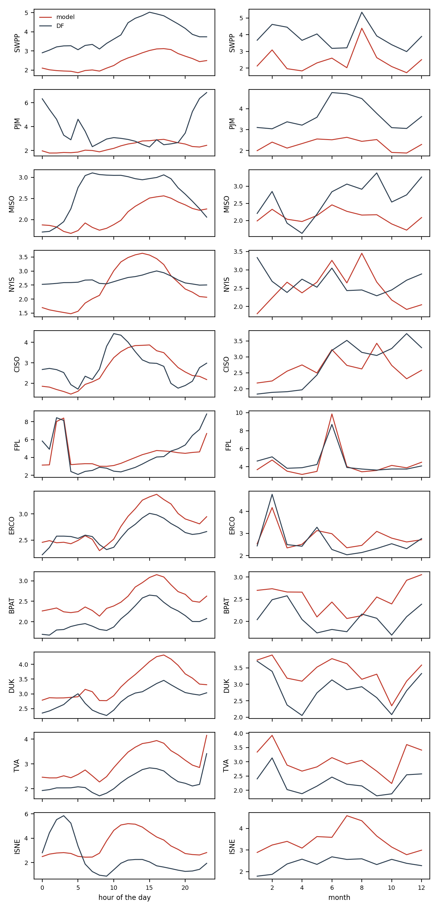

# Where the model loses to the BA's forecast

Hourly percentage errors of `final2` and of the BA's own forecast (`DF`) on the development period, documented load-shed days left out. `mape_gap` is the model's MAPE minus the BA's: positive where the BA is better. `bias` is the mean signed error: negative means under-forecast.

## By BA

| ba | mape_model | mape_df | bias_model | bias_df | n | mape_gap |
| --- | --- | --- | --- | --- | --- | --- |
| SWPP | 2.43 | 3.86 | 0.24 | 3.18 | 18070 | -1.43 |
| PJM | 2.30 | 3.66 | 0.20 | -1.23 | 18166 | -1.36 |
| MISO | 2.10 | 2.65 | 0.26 | 2.18 | 18091 | -0.55 |
| NYIS | 2.48 | 2.67 | 0.14 | -2.35 | 18190 | -0.19 |
| CISO | 2.65 | 2.79 | 0.09 | -1.20 | 18134 | -0.14 |
| FPL | 4.32 | 4.39 | 0.35 | -2.07 | 17602 | -0.07 |
| ERCO | 2.79 | 2.63 | 0.31 | 0.19 | 18046 | 0.16 |
| BPAT | 2.55 | 2.08 | 0.08 | 0.45 | 18142 | 0.47 |
| DUK | 3.37 | 2.85 | 0.49 | 0.35 | 18165 | 0.52 |
| TVA | 3.06 | 2.27 | 0.69 | 0.44 | 18071 | 0.79 |
| ISNE | 3.43 | 2.36 | 0.29 | -1.41 | 18190 | 1.07 |

## SWPP

MAPE 2.43 % against 3.86 % for `DF`. Largest gaps by hour: 0h (+-0.80), 1h (+-1.03), 8h (+-1.15), 5h (+-1.20); by month: 6 (+-0.59), 8 (+-0.96), 7 (+-1.19). Model bias from 10h to 15h minus its bias at night: +0.31 points; midday bias by year: {2020: 0.38, 2021: 0.6, 2022: 0.1}.

## PJM

MAPE 2.30 % against 3.66 % for `DF`. Largest gaps by hour: 15h (+0.52), 17h (+0.45), 14h (+0.29), 18h (+0.23); by month: 2 (+-0.64), 4 (+-0.88), 5 (+-1.04). Model bias from 10h to 15h minus its bias at night: +0.25 points; midday bias by year: {2020: -0.03, 2021: 0.1, 2022: 0.46}.

## MISO

MAPE 2.10 % against 2.65 % for `DF`. Largest gaps by hour: 23h (+0.19), 0h (+0.17), 1h (+0.14), 2h (+0.01); by month: 4 (+0.34), 3 (+0.12), 5 (+-0.04). Model bias from 10h to 15h minus its bias at night: +0.30 points; midday bias by year: {2020: 0.06, 2021: 0.29, 2022: 0.54}.

## NYIS

MAPE 2.48 % against 2.67 % for `DF`. Largest gaps by hour: 14h (+0.78), 13h (+0.78), 12h (+0.71), 15h (+0.63); by month: 8 (+1.00), 9 (+0.37), 3 (+0.28). Model bias from 10h to 15h minus its bias at night: +0.35 points; midday bias by year: {2020: -1.08, 2021: 0.36, 2022: 0.3}.

## CISO

MAPE 2.65 % against 2.79 % for `DF`. Largest gaps by hour: 18h (+1.13), 19h (+1.01), 15h (+0.88), 14h (+0.71); by month: 4 (+0.78), 3 (+0.65), 9 (+0.38). Model bias from 10h to 15h minus its bias at night: -0.27 points; midday bias by year: {2020: 0.67, 2021: -0.69, 2022: 0.17}.

## FPL

MAPE 4.32 % against 4.39 % for `DF`. Largest gaps by hour: 5h (+1.16), 13h (+1.10), 14h (+1.05), 12h (+1.04); by month: 6 (+1.16), 12 (+0.41), 10 (+0.40). Model bias from 10h to 15h minus its bias at night: -1.02 points; midday bias by year: {2020: -0.15, 2021: 0.52, 2022: -0.65}.

## ERCO

MAPE 2.79 % against 2.63 % for `DF`. Largest gaps by hour: 16h (+0.39), 18h (+0.37), 17h (+0.36), 14h (+0.34); by month: 9 (+0.77), 6 (+0.71), 8 (+0.32). Model bias from 10h to 15h minus its bias at night: +0.42 points; midday bias by year: {2020: -0.79, 2021: 0.4, 2022: 0.7}.

## BPAT

MAPE 2.55 % against 2.08 % for `DF`. Largest gaps by hour: 1h (+0.62), 17h (+0.62), 0h (+0.57), 18h (+0.56); by month: 11 (+0.82), 10 (+0.70), 12 (+0.67). Model bias from 10h to 15h minus its bias at night: +0.12 points; midday bias by year: {2020: -0.24, 2021: 0.06, 2022: 0.15}.

## DUK

MAPE 3.37 % against 2.85 % for `DF`. Largest gaps by hour: 16h (+0.91), 15h (+0.88), 18h (+0.87), 17h (+0.86); by month: 4 (+1.04), 3 (+0.82), 7 (+0.79). Model bias from 10h to 15h minus its bias at night: +0.17 points; midday bias by year: {2020: 1.08, 2021: 0.3, 2022: 0.7}.

## TVA

MAPE 3.06 % against 2.27 % for `DF`. Largest gaps by hour: 16h (+1.13), 17h (+1.12), 19h (+1.08), 13h (+1.07); by month: 11 (+1.06), 1 (+0.94), 8 (+0.90). Model bias from 10h to 15h minus its bias at night: +0.18 points; midday bias by year: {2020: 1.47, 2021: 0.11, 2022: 1.42}.

## ISNE

MAPE 3.43 % against 2.36 % for `DF`. Largest gaps by hour: 10h (+3.23), 11h (+3.14), 12h (+2.99), 13h (+2.90); by month: 7 (+2.03), 8 (+1.76), 2 (+1.36). Model bias from 10h to 15h minus its bias at night: -0.26 points; midday bias by year: {2020: 0.15, 2021: -0.47, 2022: 0.51}.

