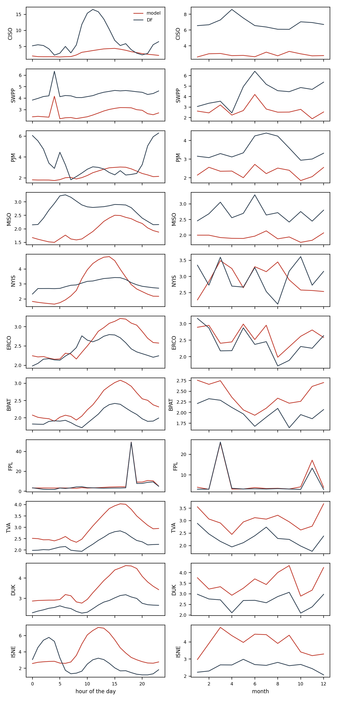

# Where the model loses to the BA's forecast

Hourly percentage errors of `final2` and of the BA's own forecast (`DF`) on the development period, documented load-shed days left out. `mape_gap` is the model's MAPE minus the BA's: positive where the BA is better. `bias` is the mean signed error: negative means under-forecast.

## By BA

| ba | mape_model | mape_df | bias_model | bias_df | n | mape_gap |
| --- | --- | --- | --- | --- | --- | --- |
| CISO | 2.88 | 6.87 | 0.11 | -4.39 | 26132 | -4.00 |
| SWPP | 2.71 | 4.42 | 0.23 | 2.58 | 26276 | -1.71 |
| PJM | 2.31 | 3.48 | 0.13 | -1.40 | 26110 | -1.17 |
| MISO | 1.94 | 2.71 | 0.16 | 2.36 | 26233 | -0.77 |
| NYIS | 2.91 | 2.97 | 0.32 | -2.54 | 26200 | -0.06 |
| ERCO | 2.62 | 2.41 | -0.00 | 0.69 | 26229 | 0.21 |
| BPAT | 2.40 | 2.01 | 0.10 | 0.02 | 26301 | 0.39 |
| FPL | 6.56 | 5.97 | 3.50 | 3.13 | 25931 | 0.59 |
| TVA | 3.03 | 2.28 | 0.21 | 1.01 | 26301 | 0.75 |
| DUK | 3.53 | 2.66 | 0.49 | 0.59 | 26157 | 0.87 |
| ISNE | 3.93 | 2.56 | 0.45 | -1.73 | 26203 | 1.36 |

## CISO

MAPE 2.88 % against 6.87 % for `DF`. Largest gaps by hour: 20h (+0.40), 19h (+0.18), 21h (+-0.27), 4h (+-0.50); by month: 9 (+-2.79), 7 (+-3.19), 8 (+-3.36). Model bias from 10h to 15h minus its bias at night: -0.24 points; midday bias by year: {2023: -0.32, 2024: -0.97, 2025: 1.24}.

## SWPP

MAPE 2.71 % against 4.42 % for `DF`. Largest gaps by hour: 16h (+-1.45), 0h (+-1.46), 18h (+-1.46), 17h (+-1.49); by month: 4 (+-0.21), 3 (+-0.35), 1 (+-0.44). Model bias from 10h to 15h minus its bias at night: +0.04 points; midday bias by year: {2023: 0.34, 2024: 0.37, 2025: -0.14}.

## PJM

MAPE 2.31 % against 3.48 % for `DF`. Largest gaps by hour: 17h (+0.74), 15h (+0.71), 18h (+0.54), 14h (+0.45); by month: 2 (+-0.52), 4 (+-0.76), 12 (+-0.77). Model bias from 10h to 15h minus its bias at night: +0.06 points; midday bias by year: {2023: 0.24, 2024: 0.1, 2025: -0.16}.

## MISO

MAPE 1.94 % against 2.71 % for `DF`. Largest gaps by hour: 20h (+-0.20), 22h (+-0.22), 21h (+-0.24), 23h (+-0.28); by month: 1 (+-0.46), 9 (+-0.48), 7 (+-0.51). Model bias from 10h to 15h minus its bias at night: +0.13 points; midday bias by year: {2023: 0.31, 2024: 0.1, 2025: 0.22}.

## NYIS

MAPE 2.91 % against 2.97 % for `DF`. Largest gaps by hour: 14h (+1.44), 13h (+1.43), 12h (+1.33), 11h (+1.17); by month: 8 (+1.30), 7 (+0.61), 4 (+0.54). Model bias from 10h to 15h minus its bias at night: +0.20 points; midday bias by year: {2023: -0.29, 2024: 0.23, 2025: 1.08}.

## ERCO

MAPE 2.62 % against 2.41 % for `DF`. Largest gaps by hour: 19h (+0.69), 18h (+0.67), 17h (+0.61), 20h (+0.58); by month: 11 (+0.56), 7 (+0.50), 9 (+0.41). Model bias from 10h to 15h minus its bias at night: +0.09 points; midday bias by year: {2023: 0.31, 2024: 0.24, 2025: -0.64}.

## BPAT

MAPE 2.40 % against 2.01 % for `DF`. Largest gaps by hour: 17h (+0.73), 18h (+0.73), 16h (+0.69), 19h (+0.63); by month: 11 (+0.76), 12 (+0.63), 9 (+0.57). Model bias from 10h to 15h minus its bias at night: +0.14 points; midday bias by year: {2023: 0.3, 2024: -0.07, 2025: -0.01}.

## FPL

MAPE 6.56 % against 5.97 % for `DF`. Largest gaps by hour: 21h (+1.84), 3h (+1.50), 4h (+1.46), 19h (+1.43); by month: 11 (+3.83), 10 (+1.23), 12 (+1.01). Model bias from 10h to 15h minus its bias at night: -1.55 points; midday bias by year: {2023: 0.99, 2024: 1.22, 2025: 0.22}.

## TVA

MAPE 3.03 % against 2.28 % for `DF`. Largest gaps by hour: 17h (+1.27), 18h (+1.22), 16h (+1.19), 15h (+1.14); by month: 12 (+1.29), 11 (+1.01), 8 (+0.93). Model bias from 10h to 15h minus its bias at night: +0.20 points; midday bias by year: {2023: 0.92, 2024: -0.11, 2025: -0.03}.

## DUK

MAPE 3.53 % against 2.66 % for `DF`. Largest gaps by hour: 18h (+1.53), 19h (+1.48), 17h (+1.44), 15h (+1.38); by month: 12 (+1.27), 9 (+1.26), 8 (+1.14). Model bias from 10h to 15h minus its bias at night: -0.08 points; midday bias by year: {2023: 0.51, 2024: 0.16, 2025: 0.23}.

## ISNE

MAPE 3.93 % against 2.56 % for `DF`. Largest gaps by hour: 13h (+3.84), 12h (+3.77), 14h (+3.72), 11h (+3.58); by month: 3 (+2.19), 7 (+1.79), 9 (+1.78). Model bias from 10h to 15h minus its bias at night: +0.43 points; midday bias by year: {2023: 0.55, 2024: 0.45, 2025: 0.93}.

