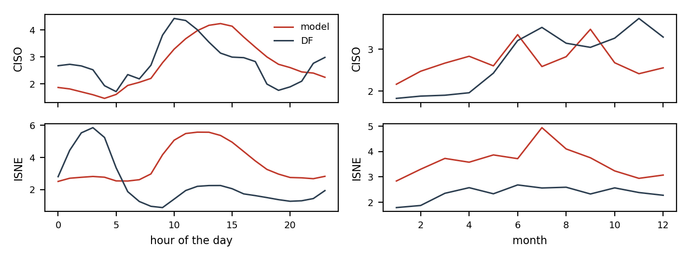

# Where the model loses to the BA's forecast

Hourly percentage errors of `ens_pv_bc_regime` and of the BA's own forecast (`DF`) on the development period, documented load-shed days left out. `mape_gap` is the model's MAPE minus the BA's: positive where the BA is better. `bias` is the mean signed error: negative means under-forecast.

## By BA

| ba | mape_model | mape_df | bias_model | bias_df | n | mape_gap |
| --- | --- | --- | --- | --- | --- | --- |
| CISO | 2.71 | 2.79 | -0.21 | -1.20 | 18134 | -0.08 |
| ISNE | 3.58 | 2.36 | 0.28 | -1.41 | 18190 | 1.22 |

## CISO

MAPE 2.71 % against 2.79 % for `DF`. Largest gaps by hour: 15h (+1.15), 14h (+1.09), 18h (+1.00), 19h (+0.96); by month: 4 (+0.87), 3 (+0.76), 2 (+0.59). Model bias from 10h to 15h minus its bias at night: -0.01 points; midday bias by year: {2020: -1.1, 2021: -0.91, 2022: 0.39}.

## ISNE

MAPE 3.58 % against 2.36 % for `DF`. Largest gaps by hour: 10h (+3.66), 11h (+3.54), 12h (+3.37), 13h (+3.31); by month: 7 (+2.38), 5 (+1.53), 8 (+1.51). Model bias from 10h to 15h minus its bias at night: +0.47 points; midday bias by year: {2020: -1.99, 2021: -0.05, 2022: 1.49}.

