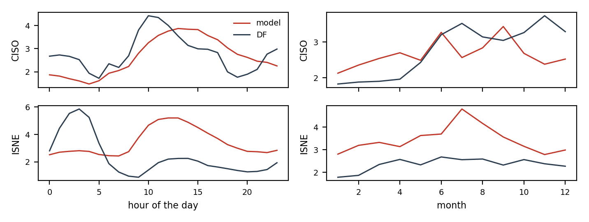

# Where the model loses to the BA's forecast

Hourly percentage errors of `ens_pv2_bc_regime` and of the BA's own forecast (`DF`) on the development period, documented load-shed days left out. `mape_gap` is the model's MAPE minus the BA's: positive where the BA is better. `bias` is the mean signed error: negative means under-forecast.

## By BA

| ba | mape_model | mape_df | bias_model | bias_df | n | mape_gap |
| --- | --- | --- | --- | --- | --- | --- |
| CISO | 2.65 | 2.79 | -0.27 | -1.20 | 18134 | -0.14 |
| ISNE | 3.42 | 2.36 | 0.11 | -1.41 | 18190 | 1.07 |

## CISO

MAPE 2.65 % against 2.79 % for `DF`. Largest gaps by hour: 18h (+1.04), 19h (+0.99), 15h (+0.83), 20h (+0.73); by month: 4 (+0.73), 3 (+0.64), 2 (+0.47). Model bias from 10h to 15h minus its bias at night: -0.20 points; midday bias by year: {2020: 0.67, 2021: -1.22, 2022: 0.22}.

## ISNE

MAPE 3.42 % against 2.36 % for `DF`. Largest gaps by hour: 10h (+3.26), 11h (+3.14), 12h (+3.00), 13h (+2.94); by month: 7 (+2.24), 8 (+1.57), 2 (+1.32). Model bias from 10h to 15h minus its bias at night: -0.05 points; midday bias by year: {2020: 0.13, 2021: -0.41, 2022: 0.59}.

