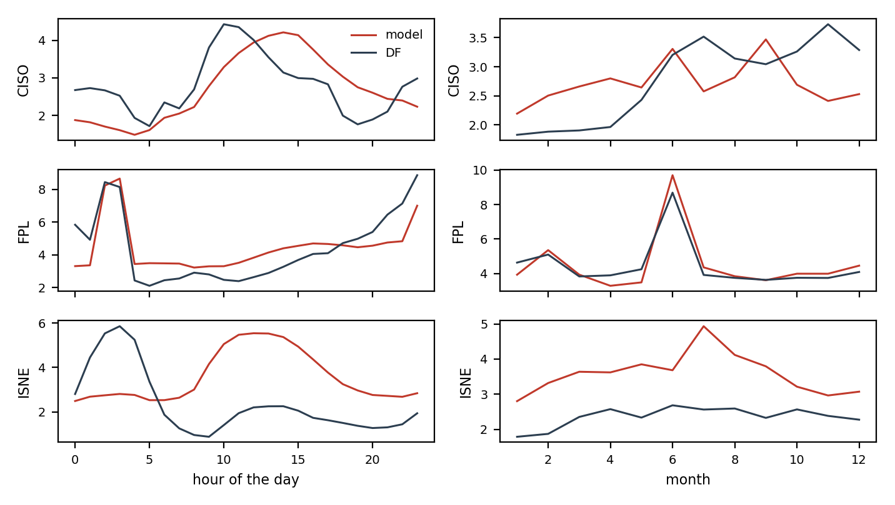

# Where the model loses to the BA's forecast

Hourly percentage errors of `ens_sky_bc_regime` and of the BA's own forecast (`DF`) on the development period, documented load-shed days left out. `mape_gap` is the model's MAPE minus the BA's: positive where the BA is better. `bias` is the mean signed error: negative means under-forecast.

## By BA

| ba | mape_model | mape_df | bias_model | bias_df | n | mape_gap |
| --- | --- | --- | --- | --- | --- | --- |
| CISO | 2.71 | 2.79 | -0.20 | -1.20 | 18134 | -0.08 |
| FPL | 4.46 | 4.39 | -0.11 | -2.07 | 17602 | 0.07 |
| ISNE | 3.57 | 2.36 | 0.27 | -1.41 | 18190 | 1.21 |

## CISO

MAPE 2.71 % against 2.79 % for `DF`. Largest gaps by hour: 15h (+1.14), 14h (+1.07), 18h (+1.04), 19h (+0.99); by month: 4 (+0.83), 3 (+0.76), 2 (+0.62). Model bias from 10h to 15h minus its bias at night: -0.01 points; midday bias by year: {2020: -1.03, 2021: -0.85, 2022: 0.34}.

## FPL

MAPE 4.46 % against 4.39 % for `DF`. Largest gaps by hour: 5h (+1.38), 13h (+1.25), 12h (+1.19), 14h (+1.13); by month: 6 (+1.01), 7 (+0.44), 12 (+0.37). Model bias from 10h to 15h minus its bias at night: -1.72 points; midday bias by year: {2020: -0.39, 2021: -0.62, 2022: -1.15}.

## ISNE

MAPE 3.57 % against 2.36 % for `DF`. Largest gaps by hour: 10h (+3.64), 11h (+3.52), 12h (+3.33), 13h (+3.27); by month: 7 (+2.37), 8 (+1.52), 5 (+1.51). Model bias from 10h to 15h minus its bias at night: +0.47 points; midday bias by year: {2020: -2.08, 2021: -0.03, 2022: 1.42}.

