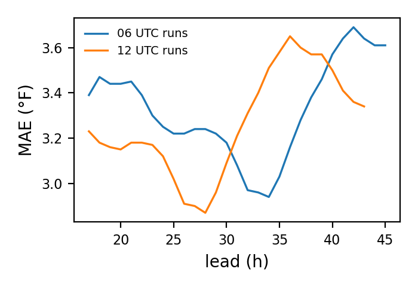
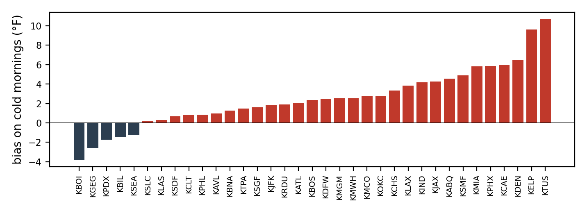

# GFS 2 m temperature against ISD-Lite observations

Forecast minus observed at the nearest 0.25 degree grid point of each station (the GFS 2 m temperature from the public archive; runs before 23 March 2021 are three-hourly and interpolated), 2021, 2022, 2023, 2024, 2025, leads 17 to 45 h of the 12 and 06 UTC runs (the leads a day-ahead forecast issued at 9 a.m. local time uses). 3215674 forecast-observation pairs at 35 stations. Observations are hourly ISD-Lite readings; a station reports to the nearest tenth of a degree Celsius.

Overall: bias -0.63 °F, MAE 3.30 °F, RMSE 4.29 °F.

On the 30 coldest mornings of each station (lowest observed minimum between 04:00 and 09:00 local time), hours 04:00 to 09:00: bias +2.49 °F, MAE 4.38 °F, 11560 pairs. A positive bias means the forecast was warmer than what occurred.

## By observed temperature

| bin | n | bias_f | mae_f | rmse_f |
| --- | --- | --- | --- | --- |
| below 20 F | 34837 | 1.46 | 4.20 | 5.43 |
| 20 to 32 F | 146253 | 0.93 | 3.37 | 4.49 |
| 32 to 59 F | 1117929 | -0.33 | 3.24 | 4.20 |
| 59 to 72 F | 813566 | -1 | 3.28 | 4.21 |
| above 72 F | 1103089 | -0.92 | 3.33 | 4.36 |

## By month

| month | n | bias_f | mae_f | rmse_f |
| --- | --- | --- | --- | --- |
| 1 | 261990 | -0.44 | 3.30 | 4.28 |
| 2 | 238781 | -0.73 | 3.43 | 4.47 |
| 3 | 273076 | -1.18 | 3.27 | 4.20 |
| 4 | 293628 | -1.60 | 3.31 | 4.23 |
| 5 | 303527 | -1.88 | 3.47 | 4.43 |
| 6 | 293819 | -1.43 | 3.53 | 4.59 |
| 7 | 303658 | -0.43 | 3.48 | 4.53 |
| 8 | 293831 | 0.14 | 3.29 | 4.32 |
| 9 | 234769 | 0.11 | 3.03 | 3.93 |
| 10 | 242772 | 0.29 | 2.96 | 3.87 |
| 11 | 234872 | 0.19 | 3.03 | 3.99 |
| 12 | 240951 | 0 | 3.31 | 4.34 |

## By station

| icao | n | bias_f | mae_f | rmse_f |
| --- | --- | --- | --- | --- |
| KABQ | 92017 | -2.79 | 4.06 | 5.10 |
| KATL | 91850 | 0.27 | 2.65 | 3.50 |
| KAVL | 91741 | -3.19 | 4.48 | 5.42 |
| KBIL | 92005 | -0.59 | 3.74 | 4.93 |
| KBNA | 92050 | -2.47 | 3.68 | 4.57 |
| KBOI | 91938 | -0.95 | 3.23 | 4.23 |
| KBOS | 92023 | -1.30 | 2.83 | 3.67 |
| KCAE | 91793 | 0.89 | 3.24 | 4.27 |
| KCHS | 92014 | 0.44 | 2.62 | 3.50 |
| KCLT | 91848 | -2.53 | 3.72 | 4.63 |
| KDEN | 92036 | 0.35 | 3.53 | 4.73 |
| KDFW | 92024 | 1.05 | 3.02 | 3.96 |
| KELP | 92050 | 0.28 | 3.71 | 4.68 |
| KGEG | 90194 | -1.60 | 3.28 | 4.32 |
| KIND | 92040 | -0.12 | 2.70 | 3.47 |
| KJAX | 92015 | 1.59 | 2.96 | 3.95 |
| KJFK | 92003 | 0.74 | 2.63 | 3.39 |
| KLAS | 91959 | -4.23 | 4.65 | 5.50 |
| KLAX | 92022 | 1.35 | 2.63 | 3.55 |
| KMCO | 91897 | 0.18 | 2.29 | 3.14 |
| KMGM | 91552 | -0.64 | 3.08 | 3.97 |
| KMIA | 92012 | 0.84 | 2.31 | 3.10 |
| KMWH | 91617 | 0.28 | 3.57 | 4.58 |
| KOKC | 91990 | 1.56 | 3.38 | 4.44 |
| KPDX | 92010 | -3.01 | 4.14 | 4.94 |
| KPHL | 91991 | -2.05 | 3.18 | 4 |
| KPHX | 91933 | 0.57 | 3.31 | 4.18 |
| KRDU | 91971 | -1.94 | 3.40 | 4.31 |
| KSDF | 91978 | -2.67 | 3.71 | 4.65 |
| KSEA | 91976 | -0.55 | 2.73 | 3.67 |
| KSGF | 91729 | -0.68 | 3.11 | 4.01 |
| KSLC | 91905 | -2.68 | 4.11 | 5.12 |
| KSMF | 91780 | 0.05 | 3.32 | 4.18 |
| KTPA | 91763 | -0.36 | 2.07 | 2.76 |
| KTUS | 91948 | 1.86 | 4.32 | 5.58 |

## Cold mornings by station

| icao | n | bias_f | mae_f | rmse_f | min_observed_f |
| --- | --- | --- | --- | --- | --- |
| KABQ | 328 | 4.55 | 5.10 | 6.23 | 6.10 |
| KATL | 328 | 2.07 | 3.18 | 3.79 | 8.10 |
| KAVL | 348 | 0.97 | 4.44 | 6.23 | 0 |
| KBIL | 302 | -1.42 | 4.82 | 6.10 | -26 |
| KBNA | 328 | 1.26 | 3.21 | 3.80 | -0.90 |
| KBOI | 360 | -3.79 | 6.04 | 7.41 | 0 |
| KBOS | 320 | 2.36 | 3.88 | 4.57 | -9 |
| KCAE | 350 | 5.98 | 6.04 | 6.90 | 12.90 |
| KCHS | 350 | 3.32 | 3.57 | 4.50 | 18 |
| KCLT | 352 | 0.79 | 2.67 | 3.60 | 9 |
| KDEN | 320 | 6.44 | 6.64 | 7.68 | -22 |
| KDFW | 304 | 2.50 | 4 | 4.52 | 1 |
| KELP | 312 | 9.60 | 9.60 | 10.39 | 14 |
| KGEG | 306 | -2.61 | 4.57 | 6.99 | -9.90 |
| KIND | 318 | 4.17 | 4.44 | 5.08 | -9 |
| KJAX | 326 | 4.27 | 4.67 | 5.49 | 19.90 |
| KJFK | 322 | 1.82 | 2.75 | 3.40 | 5 |
| KLAS | 352 | 0.31 | 1.81 | 2.28 | 28 |
| KLAX | 320 | 3.82 | 4.05 | 4.69 | 39.90 |
| KMCO | 302 | 2.73 | 3.08 | 3.83 | 30 |
| KMGM | 352 | 2.51 | 3.59 | 4.45 | 15.10 |
| KMIA | 318 | 5.84 | 5.85 | 6.62 | 42.10 |
| KMWH | 346 | 2.54 | 5.71 | 6.71 | -9 |
| KOKC | 296 | 2.74 | 3.33 | 4.20 | -9 |
| KPDX | 336 | -1.74 | 4.27 | 5.13 | 18 |
| KPHL | 342 | 0.86 | 2.59 | 3.37 | 8.10 |
| KPHX | 336 | 5.86 | 5.90 | 6.29 | 36 |
| KRDU | 330 | 1.88 | 2.59 | 3.19 | 10 |
| KSDF | 328 | 0.67 | 3.13 | 4.07 | -5.10 |
| KSEA | 352 | -1.22 | 2.91 | 3.72 | 15.10 |
| KSGF | 312 | 1.62 | 2.85 | 3.65 | -11 |
| KSLC | 352 | 0.20 | 4.15 | 4.94 | 9 |
| KSMF | 342 | 4.88 | 5.18 | 5.90 | 27 |
| KTPA | 326 | 1.49 | 2.05 | 2.54 | 32 |
| KTUS | 344 | 10.67 | 10.73 | 11.27 | 25 |

## The four winter events

All hours of the local calendar days of each event (the dates of `grid_sentinel.events`), every lead from 17 to 45 h; the last row of each event pools every station.

| icao | event | n | bias_f | mae_f | rmse_f | min_observed_f |
| --- | --- | --- | --- | --- | --- | --- |
| KABQ | uri | 114 | -1.81 | 4.16 | 4.91 | 7 |
| KATL | uri | 114 | 2.92 | 3.68 | 4.63 | 23 |
| KAVL | uri | 114 | 1.63 | 2.88 | 3.70 | 19.90 |
| KBIL | uri | 114 | -0.56 | 3.69 | 4.53 | -20 |
| KBNA | uri | 114 | 0.31 | 2.50 | 2.93 | 12 |
| KBOI | uri | 114 | -2.37 | 2.85 | 3.39 | 19.90 |
| KBOS | uri | 114 | -0.48 | 2.63 | 3.08 | 17.10 |
| KCAE | uri | 114 | 4.89 | 5.10 | 6.21 | 28 |
| KCHS | uri | 114 | 6.44 | 7.44 | 9.12 | 34 |
| KCLT | uri | 114 | 1.59 | 3.57 | 5.72 | 30 |
| KDEN | uri | 114 | 5.26 | 5.64 | 7.11 | -13 |
| KDFW | uri | 114 | -0.43 | 3.09 | 3.94 | 1 |
| KELP | uri | 114 | 5.65 | 6.35 | 8.57 | 14 |
| KGEG | uri | 114 | 1.92 | 3.09 | 4.33 | 12 |
| KIND | uri | 114 | -0.65 | 1.71 | 2.14 | 3 |
| KJAX | uri | 114 | 4.94 | 6.15 | 7.66 | 42.10 |
| KJFK | uri | 114 | -2.65 | 2.99 | 4.04 | 25 |
| KLAS | uri | 114 | -5.16 | 5.17 | 5.55 | 42.10 |
| KLAX | uri | 114 | 0.37 | 2.33 | 2.83 | 48.90 |
| KMCO | uri | 114 | 1.07 | 2.52 | 3.50 | 61 |
| KMGM | uri | 76 | -1.21 | 3.44 | 4.29 | 19 |
| KMIA | uri | 114 | 0.02 | 1.60 | 2.23 | 73 |
| KMWH | uri | 112 | 1.30 | 2.53 | 3.82 | 10 |
| KOKC | uri | 114 | -0.31 | 1.95 | 2.43 | -9 |
| KPDX | uri | 114 | -1.23 | 2.62 | 3.22 | 25 |
| KPHL | uri | 114 | -1.13 | 2.80 | 3.31 | 24.10 |
| KPHX | uri | 114 | 1.54 | 2.94 | 3.53 | 46 |
| KRDU | uri | 114 | 1.77 | 3.63 | 5.05 | 28.90 |
| KSDF | uri | 114 | -2.76 | 3.29 | 4.11 | 10.90 |
| KSEA | uri | 114 | -2.81 | 2.91 | 3.31 | 25 |
| KSGF | uri | 114 | -1.26 | 1.95 | 2.56 | -11.90 |
| KSLC | uri | 114 | -2.68 | 2.95 | 3.46 | 21.90 |
| KSMF | uri | 114 | -1.39 | 2.28 | 2.90 | 35.10 |
| KTPA | uri | 114 | -0.68 | 2.35 | 2.79 | 57 |
| KTUS | uri | 114 | 0.47 | 3.57 | 4.35 | 37.90 |
| ALL | uri | 3950 | 0.37 | 3.38 | 4.59 | -20 |
| KABQ | elliott | 280 | -0.77 | 5.20 | 6.23 | 19 |
| KATL | elliott | 280 | 0.19 | 3.11 | 4.36 | 8.10 |
| KAVL | elliott | 280 | -1.89 | 2.92 | 4.06 | 0 |
| KBIL | elliott | 280 | -6.60 | 7.22 | 8.32 | -22 |
| KBNA | elliott | 280 | -1.46 | 2.72 | 3.72 | -0.90 |
| KBOI | elliott | 280 | -1.29 | 4.67 | 6.06 | 7 |
| KBOS | elliott | 280 | 0.32 | 2.13 | 2.83 | 10.90 |
| KCAE | elliott | 280 | 1.69 | 3.44 | 4.37 | 12.90 |
| KCHS | elliott | 280 | 0.41 | 3.10 | 3.84 | 18 |
| KCLT | elliott | 280 | -0.66 | 2.76 | 3.57 | 9 |
| KDEN | elliott | 280 | 0.79 | 4.72 | 5.55 | -22 |
| KDFW | elliott | 280 | 1.54 | 3.02 | 3.87 | 10.90 |
| KELP | elliott | 280 | 2.24 | 5.74 | 6.72 | 18 |
| KGEG | elliott | 244 | -0.22 | 5.53 | 7.27 | -9.90 |
| KIND | elliott | 280 | 0.75 | 2.95 | 4.54 | -9 |
| KJAX | elliott | 280 | 2.13 | 3.46 | 4.37 | 19.90 |
| KJFK | elliott | 280 | 1.88 | 2.61 | 3.18 | 7 |
| KLAS | elliott | 280 | -1.71 | 2.58 | 3.33 | 39.90 |
| KLAX | elliott | 280 | 2.16 | 3.19 | 3.91 | 48 |
| KMCO | elliott | 280 | 1.46 | 2.50 | 3.23 | 30 |
| KMGM | elliott | 280 | -0.72 | 2.79 | 4.41 | 16 |
| KMIA | elliott | 280 | 3.91 | 4.56 | 5.38 | 46 |
| KMWH | elliott | 278 | 2.38 | 4.85 | 5.65 | -5.10 |
| KOKC | elliott | 280 | 1.48 | 2.77 | 3.53 | 3 |
| KPDX | elliott | 280 | 0.94 | 4.54 | 5.13 | 19.90 |
| KPHL | elliott | 280 | 0.33 | 1.90 | 2.66 | 8.10 |
| KPHX | elliott | 280 | 3.36 | 4.76 | 5.72 | 41 |
| KRDU | elliott | 280 | -1.44 | 2.85 | 3.72 | 10 |
| KSDF | elliott | 280 | -1.53 | 2.51 | 2.98 | -5.10 |
| KSEA | elliott | 280 | -4.58 | 4.59 | 5.52 | 18 |
| KSGF | elliott | 280 | -1.17 | 3.07 | 3.77 | -8 |
| KSLC | elliott | 280 | -3.01 | 3.27 | 4.28 | 19 |
| KSMF | elliott | 280 | 4.84 | 4.91 | 5.93 | 37 |
| KTPA | elliott | 280 | 1.72 | 2.45 | 3.07 | 32 |
| KTUS | elliott | 280 | 5.55 | 7.50 | 8.81 | 36 |
| ALL | elliott | 9762 | 0.37 | 3.73 | 4.91 | -22 |
| KABQ | gerri_heather | 336 | -1.96 | 4.77 | 5.61 | 14 |
| KATL | gerri_heather | 336 | -2.13 | 4.33 | 5.62 | 14 |
| KAVL | gerri_heather | 336 | -2.79 | 4.12 | 5.27 | 10 |
| KBIL | gerri_heather | 336 | 1.57 | 3.68 | 4.41 | -26 |
| KBNA | gerri_heather | 336 | -1.93 | 4.15 | 5.22 | 0 |
| KBOI | gerri_heather | 336 | -2.38 | 6.07 | 7.49 | 3.90 |
| KBOS | gerri_heather | 336 | -0.73 | 1.99 | 2.81 | 19 |
| KCAE | gerri_heather | 336 | 1.06 | 4.10 | 5.09 | 25 |
| KCHS | gerri_heather | 336 | -1.57 | 3.70 | 4.48 | 30.90 |
| KCLT | gerri_heather | 336 | -1.27 | 4.36 | 5.28 | 18 |
| KDEN | gerri_heather | 336 | 2.26 | 6.29 | 7.17 | -16.10 |
| KDFW | gerri_heather | 336 | 3.01 | 4.23 | 5.40 | 10.90 |
| KELP | gerri_heather | 336 | -1.92 | 5.87 | 6.49 | 21 |
| KGEG | gerri_heather | 326 | -0.19 | 2.71 | 3.44 | -9.90 |
| KIND | gerri_heather | 336 | 2.91 | 3.89 | 4.70 | -5.10 |
| KJAX | gerri_heather | 336 | -0.55 | 4.31 | 5.25 | 30 |
| KJFK | gerri_heather | 336 | 0.07 | 2.08 | 2.63 | 18 |
| KLAS | gerri_heather | 336 | -1.49 | 2.11 | 2.68 | 32 |
| KLAX | gerri_heather | 336 | 1.55 | 1.97 | 2.69 | 42.10 |
| KMCO | gerri_heather | 336 | -0.24 | 2.65 | 3.27 | 45 |
| KMGM | gerri_heather | 336 | -1.50 | 4.16 | 5.69 | 15.10 |
| KMIA | gerri_heather | 336 | -0.09 | 2 | 2.49 | 64.90 |
| KMWH | gerri_heather | 336 | 2.75 | 3.28 | 3.96 | -5.10 |
| KOKC | gerri_heather | 336 | 2.20 | 3.04 | 3.61 | 1 |
| KPDX | gerri_heather | 336 | -3.98 | 5.54 | 6.59 | 15.10 |
| KPHL | gerri_heather | 336 | -0.96 | 2.72 | 3.32 | 14 |
| KPHX | gerri_heather | 336 | 2.26 | 4.14 | 4.78 | 36 |
| KRDU | gerri_heather | 336 | -2.62 | 4.02 | 4.92 | 19 |
| KSDF | gerri_heather | 336 | 0.42 | 2.64 | 3.34 | 6.10 |
| KSEA | gerri_heather | 334 | -2.07 | 2.91 | 3.46 | 15.10 |
| KSGF | gerri_heather | 336 | 0.54 | 2.31 | 3.04 | -5.10 |
| KSLC | gerri_heather | 336 | -2.98 | 3.74 | 4.45 | 12.20 |
| KSMF | gerri_heather | 336 | -1.88 | 2.65 | 3 | 37.90 |
| KTPA | gerri_heather | 336 | -0.14 | 1.94 | 2.36 | 43 |
| KTUS | gerri_heather | 336 | 3.58 | 6.10 | 6.96 | 28.90 |
| ALL | gerri_heather | 11748 | -0.32 | 3.67 | 4.71 | -26 |
| KABQ | january_2025 | 332 | 0.16 | 3.90 | 4.67 | 6.10 |
| KATL | january_2025 | 330 | -0.08 | 2.29 | 2.88 | 14 |
| KAVL | january_2025 | 336 | -2.20 | 3.65 | 4.32 | 10 |
| KBIL | january_2025 | 336 | -3.12 | 4.68 | 6.01 | -8 |
| KBNA | january_2025 | 336 | -0.27 | 2.49 | 3.23 | 8.10 |
| KBOI | january_2025 | 336 | 0.05 | 2.87 | 3.76 | 12.90 |
| KBOS | january_2025 | 334 | -1.35 | 1.79 | 2.18 | 10 |
| KCAE | january_2025 | 333 | 0.67 | 2.71 | 3.64 | 16 |
| KCHS | january_2025 | 331 | -0.84 | 2.56 | 3.48 | 23 |
| KCLT | january_2025 | 336 | -1.38 | 2.92 | 3.76 | 19 |
| KDEN | january_2025 | 336 | -0.31 | 4.94 | 6.17 | -11.90 |
| KDFW | january_2025 | 336 | 1.89 | 2.80 | 3.53 | 21 |
| KELP | january_2025 | 330 | 4.10 | 4.92 | 5.96 | 17.10 |
| KGEG | january_2025 | 332 | -0.29 | 2.20 | 2.69 | 12.90 |
| KIND | january_2025 | 336 | 2.65 | 3.70 | 4.29 | -2.90 |
| KJAX | january_2025 | 331 | -0.92 | 2.82 | 4.01 | 30 |
| KJFK | january_2025 | 328 | -1.92 | 2.36 | 2.90 | 14 |
| KLAS | january_2025 | 336 | -5 | 5.47 | 6.61 | 28.90 |
| KLAX | january_2025 | 336 | -1.16 | 2.73 | 3.40 | 43 |
| KMCO | january_2025 | 336 | 1.82 | 3.13 | 3.93 | 39 |
| KMGM | january_2025 | 336 | -1.15 | 3.10 | 3.93 | 15.10 |
| KMIA | january_2025 | 334 | 5.73 | 6.19 | 7.50 | 48.90 |
| KMWH | january_2025 | 332 | 1.25 | 3.61 | 4.49 | 15.10 |
| KOKC | january_2025 | 336 | 3.13 | 4.06 | 4.81 | 1.90 |
| KPDX | january_2025 | 336 | -2.17 | 3.84 | 4.69 | 26.10 |
| KPHL | january_2025 | 334 | -1.98 | 2.70 | 3.52 | 10 |
| KPHX | january_2025 | 336 | 0.25 | 3.83 | 4.48 | 37.90 |
| KRDU | january_2025 | 328 | -2.35 | 3.34 | 4.07 | 17.10 |
| KSDF | january_2025 | 336 | -0.78 | 2.64 | 3.24 | 3.90 |
| KSEA | january_2025 | 332 | -0.88 | 1.81 | 2.18 | 27 |
| KSGF | january_2025 | 336 | 1.86 | 3.83 | 4.36 | 1 |
| KSLC | january_2025 | 336 | -1.03 | 2.42 | 3.06 | 15.10 |
| KSMF | january_2025 | 336 | 1.44 | 3.53 | 4.39 | 30.90 |
| KTPA | january_2025 | 334 | 1.72 | 2.77 | 3.78 | 37.90 |
| KTUS | january_2025 | 336 | 3.71 | 4.86 | 7.06 | 25 |
| ALL | january_2025 | 11695 | 0.04 | 3.36 | 4.39 | -11.90 |

Tables as CSV, including the error by lead and by local hour, are in `results/hrrr_verification/`.
