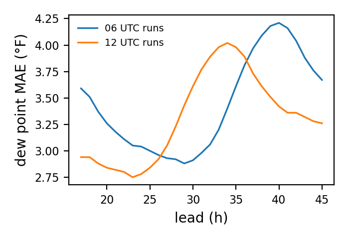
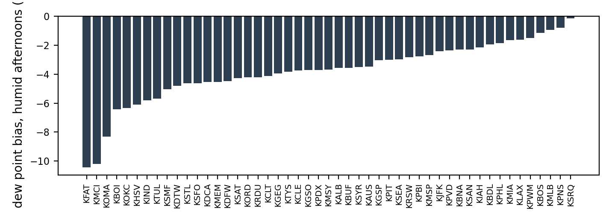

# HRRR 2 m dew point against the airport observations

Forecast minus observed at the nearest HRRR grid cell of each station, 2021, 2022, 2023, 2024, 2025, leads 17 to 45 h of the 12 and 06 UTC runs (the leads a day-ahead forecast issued at 9 a.m. local time uses). 5132818 forecast-observation pairs at 49 stations of the multi-station table. Observations are the hourly ISD-Lite dew point (tenths of a degree Celsius) and, after the ISD archive stops on 27 August 2025, the GHCNh and IEM supplements at the same airports.

Overall: bias -0.27 °F, MAE 3.38 °F, RMSE 4.66 °F. For comparison, the 2 m temperature of the same runs and stations: bias -1.23 °F, MAE 3.12 °F (`docs/hrrr_verification.md`).

On the 30 most humid afternoons of each station (highest observed dew point between 12:00 and 18:00 local time), hours 12:00 to 18:00: bias -3.84 °F, MAE 4.58 °F, 23395 pairs. A positive bias means the forecast was more humid than what occurred.

## By observed dew point

| bin | n | bias_f | mae_f | rmse_f |
| --- | --- | --- | --- | --- |
| below 20 F | 388861 | 2.23 | 4.77 | 6.13 |
| 20 to 40 F | 1309682 | 1.47 | 3.98 | 5.28 |
| 40 to 55 F | 1261201 | -0.76 | 3.30 | 4.57 |
| 55 to 65 F | 1105296 | -1.37 | 3.04 | 4.24 |
| above 65 F | 1067778 | -1.60 | 2.59 | 3.63 |

## By month

| month | n | bias_f | mae_f | rmse_f |
| --- | --- | --- | --- | --- |
| 1 | 430554 | 1.43 | 3.68 | 4.89 |
| 2 | 396727 | 1.70 | 3.86 | 5.16 |
| 3 | 436745 | 1.25 | 3.77 | 5.11 |
| 4 | 420733 | 0.39 | 3.36 | 4.62 |
| 5 | 437391 | -0.34 | 2.91 | 4.05 |
| 6 | 422722 | -1.38 | 3.14 | 4.43 |
| 7 | 437301 | -1.91 | 3.24 | 4.59 |
| 8 | 434635 | -2.04 | 3.32 | 4.66 |
| 9 | 421100 | -1.90 | 3.27 | 4.57 |
| 10 | 435085 | -1.54 | 3.36 | 4.70 |
| 11 | 423573 | 0.19 | 3.27 | 4.46 |
| 12 | 436252 | 1.06 | 3.39 | 4.58 |

## By local hour

| local_hour | n | bias_f | mae_f | rmse_f |
| --- | --- | --- | --- | --- |
| 0 | 266944 | -0.04 | 3.11 | 4.42 |
| 1 | 264467 | -0.06 | 3.08 | 4.38 |
| 2 | 246886 | -0.02 | 3.04 | 4.33 |
| 3 | 241143 | 0 | 3.01 | 4.30 |
| 4 | 213262 | 0 | 2.90 | 4.13 |
| 5 | 177159 | -0.10 | 2.82 | 3.92 |
| 6 | 178074 | -0.21 | 2.84 | 3.95 |
| 7 | 176649 | -0.37 | 2.89 | 4.01 |
| 8 | 176204 | -0.49 | 2.97 | 4.11 |
| 9 | 177384 | -0.49 | 3.11 | 4.27 |
| 10 | 177411 | -0.49 | 3.31 | 4.50 |
| 11 | 177406 | -0.56 | 3.52 | 4.73 |
| 12 | 178130 | -0.74 | 3.72 | 4.95 |
| 13 | 176648 | -0.85 | 3.87 | 5.11 |
| 14 | 176262 | -0.87 | 3.98 | 5.26 |
| 15 | 193716 | -0.77 | 4.01 | 5.33 |
| 16 | 199319 | -0.63 | 4.07 | 5.43 |
| 17 | 229808 | -0.31 | 3.99 | 5.36 |
| 18 | 267159 | -0.06 | 3.82 | 5.17 |
| 19 | 264966 | 0 | 3.67 | 5 |
| 20 | 248064 | -0.02 | 3.54 | 4.83 |
| 21 | 260623 | -0.08 | 3.40 | 4.68 |
| 22 | 235568 | -0.11 | 3.26 | 4.51 |
| 23 | 229566 | -0.14 | 3.14 | 4.35 |

## By station

| icao | n | bias_f | mae_f | rmse_f |
| --- | --- | --- | --- | --- |
| KALB | 105560 | 0.85 | 3.39 | 4.47 |
| KAUS | 105441 | -0.33 | 2.95 | 4.15 |
| KBDL | 105565 | 1.58 | 3.55 | 4.75 |
| KBNA | 105571 | 0.96 | 3.84 | 5.03 |
| KBOI | 105470 | -1.98 | 4.61 | 6 |
| KBOS | 105532 | 1.20 | 3.23 | 4.43 |
| KBUF | 99944 | -0.11 | 3.16 | 4.20 |
| KCLE | 105549 | -0.05 | 3.33 | 4.40 |
| KCLT | 105383 | -1 | 3.87 | 5.17 |
| KDCA | 105519 | 0.01 | 3.74 | 4.92 |
| KDFW | 105550 | 0.09 | 3.46 | 4.73 |
| KDTW | 99753 | -0.62 | 3.35 | 4.45 |
| KFAT | 105521 | -4.03 | 5.28 | 7.03 |
| KGEG | 103824 | -0.80 | 3.77 | 4.94 |
| KGSO | 105580 | -0.37 | 3.69 | 4.94 |
| KGSP | 105237 | 0.03 | 4 | 5.30 |
| KHSV | 104085 | -1.73 | 4.63 | 6.97 |
| KIAH | 105599 | -0.62 | 2.82 | 3.99 |
| KIND | 105581 | -0.18 | 3.43 | 4.50 |
| KJFK | 105548 | 1.21 | 3.27 | 4.41 |
| KLAX | 105488 | -0.74 | 2.75 | 4.58 |
| KMCI | 105539 | -1.87 | 4.28 | 5.54 |
| KMEM | 105500 | 0.42 | 3.50 | 4.63 |
| KMIA | 105562 | -0.88 | 2.31 | 3.16 |
| KMLB | 105392 | -0.34 | 2.09 | 2.87 |
| KMSP | 87987 | 0.96 | 3.71 | 4.83 |
| KMSY | 105277 | -0.85 | 2.84 | 3.82 |
| KOKC | 105536 | -1.91 | 4.09 | 5.47 |
| KOMA | 105315 | -0.78 | 3.73 | 4.88 |
| KORD | 105553 | -0.22 | 3.36 | 4.40 |
| KPBI | 105518 | -0.82 | 2.22 | 3.06 |
| KPDX | 105535 | 1.40 | 3.06 | 4.22 |
| KPHL | 105528 | 1.53 | 3.60 | 4.78 |
| KPIT | 105566 | 0.35 | 3.55 | 4.71 |
| KPNS | 104674 | 0.74 | 3.04 | 4.19 |
| KPVD | 105257 | 1.35 | 3.33 | 4.57 |
| KPWM | 105327 | 1.22 | 3.22 | 4.39 |
| KRDU | 105518 | -0.85 | 3.53 | 4.74 |
| KRSW | 102430 | -1.28 | 2.57 | 3.62 |
| KSAN | 105502 | -0.59 | 2.64 | 4.30 |
| KSAT | 105540 | -1.37 | 3.26 | 4.66 |
| KSEA | 105507 | 0.57 | 2.61 | 3.63 |
| KSFO | 105473 | 0.06 | 2.26 | 3.23 |
| KSMF | 105393 | -0.59 | 3.12 | 4.22 |
| KSRQ | 105106 | -0.74 | 2.32 | 3.44 |
| KSTL | 105467 | -0.23 | 3.73 | 4.84 |
| KSYR | 105524 | 0.77 | 3.45 | 4.52 |
| KTUL | 105522 | -1.22 | 4.06 | 5.36 |
| KTYS | 105470 | -1.31 | 4 | 5.30 |

## Humid afternoons by station

| icao | n | bias_f | mae_f | rmse_f | max_observed_f |
| --- | --- | --- | --- | --- | --- |
| KALB | 450 | -3.57 | 4.39 | 5.52 | 78.10 |
| KAUS | 510 | -3.48 | 4.27 | 5.19 | 79 |
| KBDL | 449 | -1.94 | 2.97 | 3.90 | 77 |
| KBNA | 480 | -2.30 | 3.40 | 4.26 | 77 |
| KBOI | 533 | -6.43 | 7.51 | 9.11 | 66.90 |
| KBOS | 449 | -1.15 | 2.62 | 3.38 | 77 |
| KBUF | 450 | -3.56 | 3.92 | 4.94 | 75 |
| KCLE | 450 | -3.73 | 4.30 | 5.35 | 77 |
| KCLT | 450 | -4.12 | 4.83 | 6.13 | 77 |
| KDCA | 450 | -4.53 | 4.92 | 6.10 | 78.10 |
| KDFW | 480 | -4.49 | 5.63 | 7.53 | 80.60 |
| KDTW | 480 | -4.80 | 5.45 | 6.44 | 77 |
| KFAT | 536 | -10.43 | 11.06 | 13.57 | 66.90 |
| KGEG | 540 | -3.96 | 5.47 | 6.84 | 64.90 |
| KGSO | 450 | -3.72 | 4.07 | 5.11 | 77 |
| KGSP | 450 | -3.05 | 3.72 | 4.71 | 75.90 |
| KHSV | 480 | -6.09 | 6.23 | 7.26 | 82 |
| KIAH | 480 | -2.15 | 3.25 | 4.21 | 81 |
| KIND | 473 | -5.80 | 6.10 | 7.36 | 80.10 |
| KJFK | 442 | -2.43 | 2.74 | 3.42 | 78.10 |
| KLAX | 536 | -1.63 | 2.54 | 3.27 | 72 |
| KMCI | 480 | -10.20 | 10.24 | 11.55 | 82.90 |
| KMEM | 477 | -4.53 | 5.02 | 5.89 | 80.10 |
| KMIA | 450 | -1.64 | 2.85 | 3.63 | 80.10 |
| KMLB | 450 | -0.93 | 2.38 | 3.12 | 80.10 |
| KMSP | 396 | -2.69 | 3.45 | 4.33 | 78.10 |
| KMSY | 480 | -3.69 | 4.07 | 4.89 | 81 |
| KOKC | 510 | -6.34 | 6.54 | 8.80 | 79 |
| KOMA | 480 | -8.31 | 8.47 | 9.32 | 81 |
| KORD | 473 | -4.22 | 4.93 | 5.97 | 80.10 |
| KPBI | 450 | -2.77 | 3.38 | 4.17 | 84 |
| KPDX | 540 | -3.71 | 4.16 | 5.37 | 68 |
| KPHL | 450 | -1.86 | 2.47 | 3.25 | 79 |
| KPIT | 450 | -3.01 | 3.52 | 4.36 | 75.90 |
| KPNS | 475 | -0.80 | 2.25 | 2.98 | 81 |
| KPVD | 450 | -2.37 | 2.75 | 3.49 | 78.10 |
| KPWM | 449 | -1.51 | 2.37 | 3.03 | 78.10 |
| KRDU | 449 | -4.21 | 4.55 | 5.57 | 80.10 |
| KRSW | 450 | -2.82 | 3.41 | 4.27 | 81 |
| KSAN | 529 | -2.29 | 3.06 | 3.77 | 73.90 |
| KSAT | 510 | -4.27 | 4.84 | 6.57 | 77 |
| KSEA | 540 | -2.99 | 3.72 | 5.33 | 66 |
| KSFO | 540 | -4.63 | 5.56 | 7.13 | 68 |
| KSMF | 529 | -5.04 | 5.79 | 7.60 | 66 |
| KSRQ | 480 | -0.14 | 2.35 | 3.02 | 81 |
| KSTL | 480 | -4.64 | 5.24 | 6.41 | 80.10 |
| KSYR | 450 | -3.51 | 3.87 | 4.75 | 78.10 |
| KTUL | 480 | -5.68 | 6.65 | 8.22 | 80.10 |
| KTYS | 480 | -3.83 | 4.31 | 5.13 | 78.10 |

Tables as CSV, including the error by lead, are in `results/hrrr_dewpoint_verification/`.
