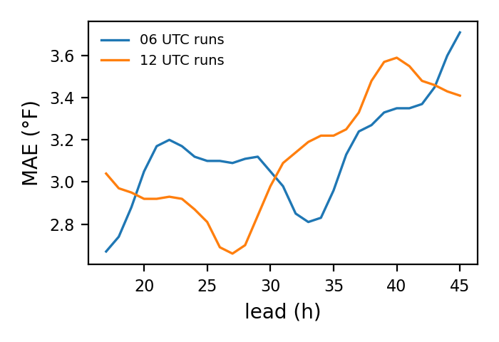
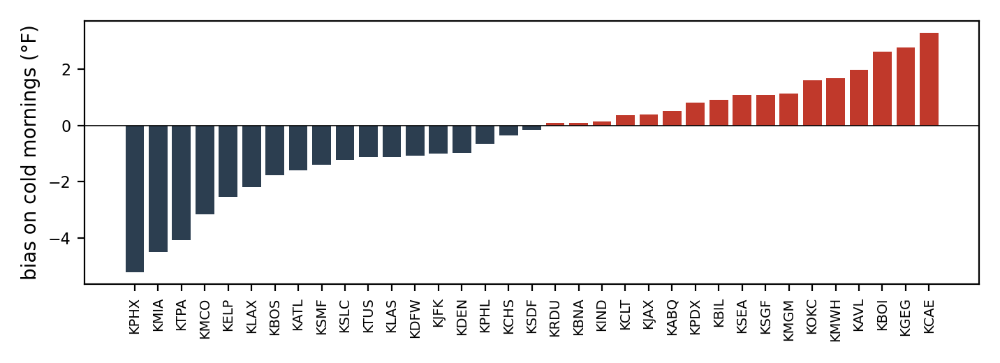

# HRRR 2 m temperature against ISD-Lite observations

Forecast minus observed at the nearest HRRR grid cell of each station, 2024, leads 17 to 45 h of the 12 and 06 UTC runs (the leads a day-ahead forecast issued at 9 a.m. local time uses). 738101 forecast-observation pairs at 35 stations. Observations are hourly ISD-Lite readings; a station reports to the nearest tenth of a degree Celsius.

Overall: bias -1.42 °F, MAE 3.13 °F, RMSE 4.01 °F.

On the 30 coldest mornings of each station (lowest observed minimum between 04:00 and 09:00 local time), hours 04:00 to 09:00: bias -0.40 °F, MAE 3.01 °F, 12814 pairs. A positive bias means the forecast was warmer than what occurred.

## By observed temperature

| bin | n | bias_f | mae_f | rmse_f |
| --- | --- | --- | --- | --- |
| below 20 F | 6408 | 0.73 | 3.24 | 4.23 |
| 20 to 32 F | 28400 | 0.53 | 2.95 | 3.90 |
| 32 to 59 F | 269929 | -1.68 | 3.13 | 3.95 |
| 59 to 72 F | 187543 | -1.72 | 3.14 | 4.02 |
| above 72 F | 245821 | -1.20 | 3.13 | 4.07 |

## By month

| month | n | bias_f | mae_f | rmse_f |
| --- | --- | --- | --- | --- |
| 1 | 60287 | -1.41 | 3.31 | 4.23 |
| 2 | 58815 | -1.67 | 3.19 | 4.02 |
| 3 | 62603 | -1.86 | 3.24 | 4.08 |
| 4 | 60771 | -1.59 | 3.08 | 3.96 |
| 5 | 62747 | -1.48 | 2.97 | 3.87 |
| 6 | 60865 | -0.50 | 3.02 | 3.97 |
| 7 | 62904 | -0.54 | 3.05 | 4.02 |
| 8 | 62909 | -0.64 | 2.99 | 3.92 |
| 9 | 60699 | -1.29 | 2.88 | 3.71 |
| 10 | 62814 | -2.10 | 3.24 | 4.01 |
| 11 | 60811 | -2.30 | 3.40 | 4.25 |
| 12 | 61876 | -1.74 | 3.18 | 4.05 |

## By station

| icao | n | bias_f | mae_f | rmse_f |
| --- | --- | --- | --- | --- |
| KABQ | 21154 | -0.49 | 3.01 | 3.81 |
| KATL | 21146 | -1.90 | 3.17 | 4.02 |
| KAVL | 20919 | -1.40 | 3.16 | 4 |
| KBIL | 21104 | 0.75 | 3.01 | 4.07 |
| KBNA | 21123 | -1.52 | 3.01 | 3.94 |
| KBOI | 21103 | -0.32 | 2.58 | 3.39 |
| KBOS | 21140 | -2.08 | 3.23 | 4.17 |
| KCAE | 21104 | -0.51 | 2.85 | 3.68 |
| KCHS | 21121 | -1.60 | 2.58 | 3.37 |
| KCLT | 21097 | -1.47 | 2.96 | 3.82 |
| KDEN | 21133 | 0.09 | 3.31 | 4.47 |
| KDFW | 21133 | -1.13 | 2.90 | 3.73 |
| KELP | 21154 | -3.46 | 4.26 | 5.26 |
| KGEG | 20909 | -0.65 | 2.81 | 3.61 |
| KIND | 21119 | -0.88 | 2.59 | 3.40 |
| KJAX | 21131 | -0.68 | 2.41 | 3.21 |
| KJFK | 21110 | -2.88 | 3.53 | 4.41 |
| KLAS | 21050 | -2.09 | 3.87 | 4.74 |
| KLAX | 21118 | -2.29 | 2.89 | 3.63 |
| KMCO | 21103 | -1.64 | 2.67 | 3.46 |
| KMGM | 21037 | 0.08 | 2.70 | 3.56 |
| KMIA | 21119 | -2.97 | 3.46 | 4.17 |
| KMWH | 21137 | 0.53 | 2.95 | 3.74 |
| KOKC | 21098 | 1.10 | 3 | 3.95 |
| KPDX | 21099 | -2.40 | 3.64 | 4.34 |
| KPHL | 21095 | -2.29 | 3.33 | 4.20 |
| KPHX | 21097 | -3.94 | 4.75 | 5.76 |
| KRDU | 21072 | -2.19 | 3.14 | 3.94 |
| KSDF | 21056 | -1.91 | 3.16 | 4.04 |
| KSEA | 21073 | -1.15 | 2.48 | 3.13 |
| KSGF | 21096 | 0.31 | 2.89 | 3.77 |
| KSLC | 21106 | -1.82 | 3.40 | 4.28 |
| KSMF | 21052 | -2.44 | 3.18 | 3.87 |
| KTPA | 20965 | -2.86 | 3.42 | 4.08 |
| KTUS | 21028 | -1.75 | 3.18 | 4.11 |

## Cold mornings by station

| icao | n | bias_f | mae_f | rmse_f | min_observed_f |
| --- | --- | --- | --- | --- | --- |
| KABQ | 360 | 0.50 | 2.35 | 2.92 | 14 |
| KATL | 360 | -1.59 | 1.95 | 2.47 | 14 |
| KAVL | 360 | 1.98 | 4.08 | 4.83 | 10 |
| KBIL | 358 | 0.91 | 3.49 | 4.46 | -26 |
| KBNA | 360 | 0.10 | 2.61 | 3.33 | 0 |
| KBOI | 358 | 2.61 | 3.29 | 4.30 | 3.90 |
| KBOS | 389 | -1.77 | 2.86 | 3.35 | 10 |
| KCAE | 390 | 3.29 | 4.09 | 4.72 | 19 |
| KCHS | 389 | -0.36 | 2.16 | 2.67 | 23 |
| KCLT | 389 | 0.36 | 2.32 | 3.10 | 14 |
| KDEN | 360 | -0.99 | 3.24 | 4.17 | -11.90 |
| KDFW | 360 | -1.07 | 2.25 | 2.81 | 10.90 |
| KELP | 360 | -2.55 | 3.31 | 4.08 | 21 |
| KGEG | 336 | 2.76 | 3.53 | 4.04 | -9.90 |
| KIND | 360 | 0.14 | 3.17 | 3.96 | -5.10 |
| KJAX | 389 | 0.38 | 1.73 | 2.15 | 28 |
| KJFK | 389 | -1 | 2.57 | 3.22 | 12.90 |
| KLAS | 360 | -1.12 | 2.57 | 3.20 | 30.90 |
| KLAX | 360 | -2.20 | 2.79 | 3.27 | 42.10 |
| KMCO | 386 | -3.16 | 3.69 | 4.19 | 37.90 |
| KMGM | 352 | 1.12 | 2.29 | 2.85 | 15.10 |
| KMIA | 389 | -4.50 | 4.57 | 5.07 | 52 |
| KMWH | 360 | 1.68 | 3.46 | 4.24 | -5.10 |
| KOKC | 358 | 1.60 | 2.64 | 3.35 | 1 |
| KPDX | 358 | 0.82 | 3.23 | 4.62 | 18 |
| KPHL | 387 | -0.65 | 2.60 | 3.41 | 12 |
| KPHX | 358 | -5.22 | 5.22 | 5.58 | 36 |
| KRDU | 379 | 0.10 | 2.27 | 2.85 | 19 |
| KSDF | 360 | -0.17 | 2.70 | 3.63 | 3 |
| KSEA | 350 | 1.07 | 2.84 | 3.58 | 15.10 |
| KSGF | 360 | 1.09 | 2.52 | 3.18 | -5.10 |
| KSLC | 360 | -1.24 | 3.73 | 4.90 | 12.20 |
| KSMF | 358 | -1.40 | 2.52 | 3.08 | 32 |
| KTPA | 352 | -4.08 | 4.17 | 4.51 | 37 |
| KTUS | 360 | -1.13 | 2.59 | 3.15 | 28 |

Tables as CSV, including the error by lead and by local hour, are in `results/hrrr_verification/`.
