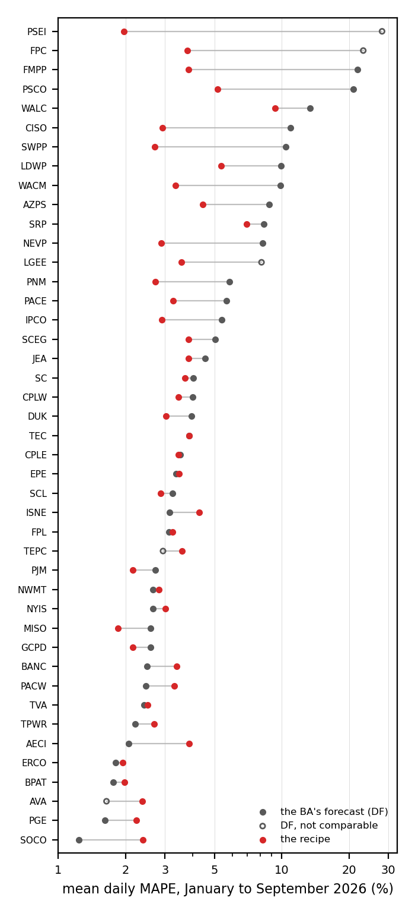

# The recipe against each BA's own forecast on the 43 BAs, January to September 2026

Daily rows of the test on 2026 (`run_phase_e.py --groups t2026`, run from 2025-01-01 to 2026-09-30, scored from 2026-01-01; 9 a.m. cut-off, protocol v2; `docs/test_2026_protocol.md`),
on the days both `recipe2026` and `DF` scored. MAPE is the mean of the daily MAPE in percent of the actual; peak under-forecast
in percent of the actual peak (negative is under); coverage and Winkler score of the 90 % band of `recipe2026`. DM is the
Diebold-Mariano statistic of the daily MAPE of `recipe2026` against `DF` (negative: the recipe's errors are smaller; `*` for
p < 0.05, two-sided, normal approximation). Gap is MAPE of the recipe minus MAPE of `DF`; negative is better.

(a) The EIA lists the day-ahead forecast of these BAs as not comparable with their demand (a different basis or a subset of
the system): AVA, FPC, LGEE, PSEI, TEPC. They stay in the evaluation of the forecaster and are left out of the aggregates
against `DF`.

## Aggregates

Weighted means use each BA's mean demand on the days scored as the weight.

| set | BAs | MAPE recipe, weighted | MAPE DF, weighted | MAPE recipe, median | MAPE DF, median | BAs better | BAs worse | better, p < 0.05 | worse, p < 0.05 | coverage 90 |
| --- | --- | --- | --- | --- | --- | --- | --- | --- | --- | --- |
| all 43 BAs, forecaster only | 43 | 2.62 | 4.62 | 3.26 | 3.85 | 27 | 16 | 25 | 13 | 0.899 |
| 38 comparable BAs | 38 | 2.60 | 4.22 | 3.25 | 3.68 | 24 | 14 | 22 | 11 | 0.899 |
| 11 development BAs | 11 | 2.37 | 3.87 | 2.69 | 2.72 | 5 | 6 | 5 | 4 | 0.899 |
| 27 new comparable BAs | 27 | 3.47 | 5.56 | 3.45 | 4.01 | 19 | 8 | 17 | 7 | 0.898 |

## By BA, sorted by the gap

| BA | set | mean MW | days | MAPE recipe | MAPE DF | gap | DM | peak under recipe | peak under DF | coverage 90 | Winkler 90 |
| --- | --- | --- | --- | --- | --- | --- | --- | --- | --- | --- | --- |
| PSEI (a) | new | 2583 | 52 | 1.97 | 28.10 | -26.13 | -26.3* | -0.90 | -30.97 | 0.909 | 9.93 |
| FPC (a) | new | 7074 | 259 | 3.78 | 23.15 | -19.37 | -72.3* | -1.82 | -25.07 | 0.895 | 22.06 |
| FMPP | new | 2306 | 262 | 3.82 | 21.83 | -18.01 | -25.1* | -3.13 | -22.25 | 0.899 | 23.97 |
| PSCO | new | 5510 | 267 | 5.16 | 20.92 | -15.76 | -35.6* | -4.46 | -26.15 | 0.887 | 30.90 |
| CISO | development | 27315 | 271 | 2.93 | 10.92 | -7.99 | -64.8* | -2.66 | -10.71 | 0.905 | 15.71 |
| SWPP | development | 36004 | 250 | 2.69 | 10.42 | -7.72 | -23.4* | -1.35 | -0.39 | 0.897 | 19.68 |
| WACM | new | 3710 | 77 | 3.35 | 9.87 | -6.52 | -18.1* | -1.63 | -12.71 | 0.940 | 23.20 |
| NEVP | new | 5188 | 260 | 2.89 | 8.23 | -5.33 | -33.8* | -1.89 | -5.88 | 0.882 | 17.09 |
| LGEE (a) | new | 4549 | 272 | 3.55 | 8.11 | -4.56 | -21.9* | -1.53 | -8.89 | 0.897 | 20.78 |
| LDWP | new | 3017 | 259 | 5.36 | 9.90 | -4.55 | -13.8* | -2.89 | -11.02 | 0.885 | 32.11 |
| AZPS | new | 4951 | 269 | 4.43 | 8.78 | -4.36 | -24.0* | -1.77 | -4.67 | 0.896 | 26.33 |
| WALC | new | 1011 | 179 | 9.34 | 13.38 | -4.04 | -9.6* | -7.07 | -12.18 | 0.837 | 58.15 |
| PNM | new | 1775 | 273 | 2.71 | 5.82 | -3.11 | -23.2* | -1.64 | -5.85 | 0.905 | 15.03 |
| IPCO | new | 2308 | 270 | 2.90 | 5.40 | -2.49 | -10.8* | -1.64 | -5.01 | 0.892 | 17.28 |
| PACE | new | 6259 | 266 | 3.26 | 5.66 | -2.40 | -15.6* | -1.91 | -1.62 | 0.876 | 18.21 |
| SRP | new | 4493 | 239 | 6.94 | 8.32 | -1.38 | -5.8* | -1.95 | -1.75 | 0.836 | 43.44 |
| SCEG | new | 3058 | 257 | 3.83 | 5.05 | -1.22 | -8.6* | -2.06 | -4.57 | 0.913 | 21.52 |
| DUK | development | 13218 | 271 | 3.03 | 3.94 | -0.91 | -3.6* | -1.22 | -2.45 | 0.907 | 17.00 |
| MISO | development | 79060 | 270 | 1.85 | 2.59 | -0.74 | -8.7* | -0.80 | -0.17 | 0.897 | 9.93 |
| JEA | new | 1660 | 272 | 3.82 | 4.55 | -0.73 | -5.6* | -2.30 | -2.14 | 0.899 | 22.01 |
| PJM | development | 100982 | 271 | 2.15 | 2.72 | -0.57 | -6.4* | -1.21 | -1.28 | 0.900 | 11.94 |
| CPLW | new | 531 | 247 | 3.45 | 3.98 | -0.53 | -2.9* | -2.09 | -3.64 | 0.920 | 20.16 |
| GCPD | new | 764 | 270 | 2.16 | 2.59 | -0.43 | -3.3* | -0.84 | -2.40 | 0.888 | 12.98 |
| SCL | new | 1057 | 272 | 2.86 | 3.24 | -0.38 | -3.3* | -1.60 | -3.76 | 0.896 | 14.97 |
| SC | new | 3371 | 261 | 3.70 | 4.01 | -0.31 | -2.5* | -2.35 | -1.98 | 0.904 | 23.24 |
| CPLE | new | 7434 | 251 | 3.45 | 3.51 | -0.06 | -0.4 | -1.50 | -2.39 | 0.896 | 20.70 |
| TEC | new | 2690 | 271 | 3.85 | 3.85 | -0.00 | -0.0 | -1.67 | -2.41 | 0.916 | 22.25 |
| TVA | development | 20383 | 268 | 2.50 | 2.41 | +0.09 | 1.1 | -1.06 | -0.59 | 0.901 | 14.46 |
| FPL | development | 17688 | 270 | 3.24 | 3.13 | +0.11 | 1.1 | -1.44 | -1.44 | 0.897 | 18.60 |
| EPE | new | 1160 | 269 | 3.48 | 3.36 | +0.12 | 1.1 | -1.57 | -2.92 | 0.896 | 20.36 |
| ERCO | development | 60207 | 272 | 1.94 | 1.80 | +0.15 | 2.1* | -0.78 | -0.77 | 0.898 | 11.03 |
| NWMT | new | 1323 | 269 | 2.81 | 2.65 | +0.16 | 2.0* | -1.88 | -2.20 | 0.885 | 17.89 |
| BPAT | development | 7269 | 271 | 1.98 | 1.76 | +0.21 | 3.0* | -1.24 | -1.26 | 0.896 | 11.28 |
| NYIS | development | 17542 | 270 | 3.02 | 2.64 | +0.37 | 3.2* | -1.05 | -2.40 | 0.904 | 16.01 |
| TPWR | new | 500 | 272 | 2.69 | 2.21 | +0.47 | 5.9* | -1.65 | -0.97 | 0.896 | 14.74 |
| PGE | new | 2681 | 272 | 2.23 | 1.62 | +0.61 | 9.1* | -1.11 | -1.13 | 0.895 | 12.99 |
| TEPC (a) | new | 1785 | 270 | 3.57 | 2.94 | +0.63 | 6.8* | -1.43 | -2.14 | 0.901 | 21.45 |
| AVA (a) | new | 1440 | 271 | 2.38 | 1.64 | +0.74 | 10.8* | -0.94 | -1.43 | 0.906 | 13.19 |
| PACW | new | 2394 | 272 | 3.29 | 2.47 | +0.83 | 6.1* | -1.81 | -1.11 | 0.902 | 22.50 |
| BANC | new | 2080 | 229 | 3.38 | 2.50 | +0.88 | 9.1* | -2.22 | -2.00 | 0.896 | 28.96 |
| ISNE | development | 13531 | 272 | 4.27 | 3.14 | +1.13 | 8.0* | -1.18 | -0.51 | 0.894 | 23.29 |
| SOCO | new | 29221 | 272 | 2.38 | 1.24 | +1.15 | 13.3* | -1.43 | -1.26 | 0.914 | 14.67 |
| AECI | new | 2607 | 272 | 3.85 | 2.07 | +1.79 | 15.3* | -2.09 | -1.10 | 0.888 | 21.02 |

